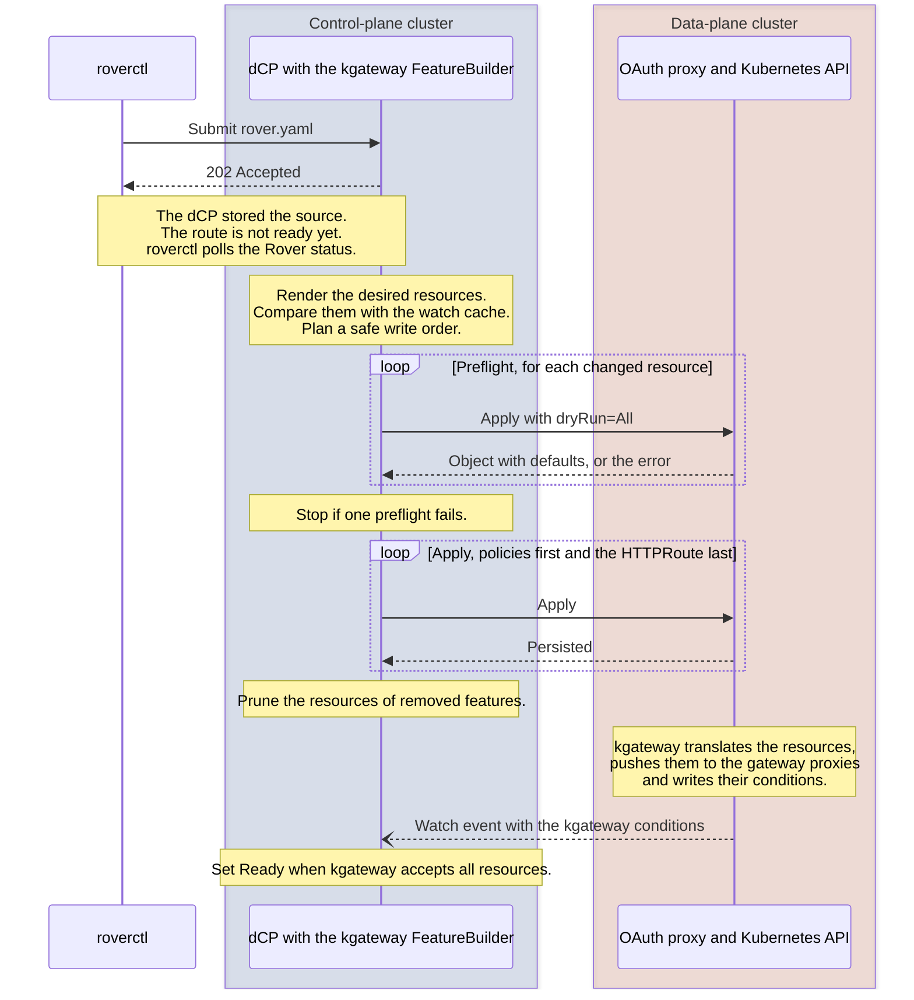
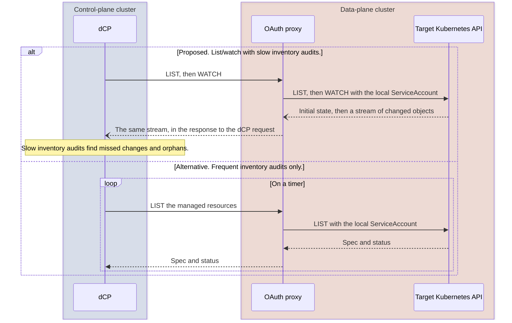

# Configure Data-Plane Resources through an OAuth-Protected Kubernetes API Proxy

## Context and Problem Statement

The [distributed control plane (dCP)](https://github.com/telekom/controlplane) translates Rover configuration into
gateway configuration. For kgateway, the dCP must manage Gateway API and kgateway resources in separate data-plane
clusters. The dCP must not get ServiceAccount credentials for the data-plane clusters. It must also not get direct
network access to their Kubernetes API servers. Access through an authenticated proxy that uses the Kubernetes API
protocol is acceptable.

We trust the configuration that the dCP renders. This record answers two questions:

- Where do translation, validation and reconciliation run?
- How does the dCP find out about changes to data-plane resources?

The decision records and the [developer documentation](../developer/) use these terms:

- **Gateway operator:** the dCP component that configures the gateways. Today, its Kong `FeatureBuilder` turns the
  features of a `gateway.Route` into Kong entities, and the Kong client writes them.
- **kgateway FeatureBuilder:** the proposed counterpart for kgateway in the Gateway operator. It renders the features as
  Gateway API and kgateway resources. It applies them through the **kgateway client**, a Kubernetes client for one
  data-plane cluster.
- **OAuth proxy:** the OAuth-protected path from the dCP to the Kubernetes API of a data-plane cluster. In ADR 0005,
  this path is the management route on kgateway and the **management proxy** Deployment behind it.

## Decision Drivers

- Reuse the dCP lifecycle. Keep one owner of the desired route configuration.
- Keep Kubernetes credentials and permission enforcement inside each data-plane cluster.
- Do not duplicate route semantics or Kubernetes API behavior in a custom service.
- Detect drift in the target clusters. Recover from missed events, partial writes and control-plane outages.
- Install nothing in a data-plane cluster beyond the gateway chart. Managed (CaaS) and NatCo clusters are partly outside
  our control, and tenants there can lack cluster-wide permissions.

## Considered Options

- A transparent, OAuth-protected Kubernetes API proxy, with reconciliation in the dCP.
- A custom route-operation API that validates and applies resource bundles.
- A data-plane controller with its own desired-state model and route reconciliation.

## Decision Outcome

Proposed option: **an OAuth-protected Kubernetes API proxy with central reconciliation**. Deploy one proxy endpoint for
each data-plane cluster. The dCP translates the configuration one time. Then it uses a Kubernetes client through that
endpoint. The proxy authenticates and authorizes the OAuth client. Then the proxy forwards the request with a local,
namespace-scoped ServiceAccount. The proxy has no route model, no work queue and no reconciliation loop of its own.

A custom route-operation API adds a route-specific contract, but no responsibility needs that contract. A data-plane
controller adds a second layer of route reconciliation. The dCP owns and renders trusted configuration, so neither
option is necessary.

### Validation belongs to the layer that owns the rule

| Layer | Responsibility |
| --- | --- |
| dCP | Validates route intent and supported features. Renders resources. Selects targets. Tracks resource ownership. Decides a safe order for creation, update and deletion. |
| OAuth proxy | Validates the access token and the permitted machine-client identity. Replaces the caller credentials with the local Kubernetes identity. Forwards requests and responses. |
| Kubernetes API server | Authorizes that identity with RBAC. Validates objects against the installed CRDs and sets their defaults. Runs the installed admission policies. Enforces native write preconditions. |
| kgateway and runtime services | Resolve resource references. Publish controller status. Configure the proxies. Enforce authentication and authorization of traffic. |

Use RBAC to limit the proxy ServiceAccount by namespace, API resource and verb. Labels identify the resources that the
dCP owns, for inventory and cleanup. Labels are not an authorization boundary. The proxy does not validate route
ownership, backend references or security-policy fields again. If other field restrictions are necessary, put them in
Kubernetes admission. Do not implement the dCP validation a second time.

Before the dCP applies rendered resources, it sends each apply with the query parameter [`dryRun=All`][k8s-dry-run].
This is the server-side dry run of the Kubernetes API. The API server runs authorization, defaulting, schema validation
and admission, but it does not persist the object. `kubectl apply --dry-run=server`
[sends the same parameter][kubectl-dry-run-source]. `--dry-run=client` sends no request
([kubectl reference][kubectl-dry-run]). In controller-runtime, the option is [`client.DryRunAll`][cr-dry-run]. The proxy
forwards the parameter unchanged.

### Keep the Kubernetes API semantics

Keep the native Kubernetes operations and responses. These include discovery, list/watch and server-side apply. The dCP
owns managed-field comparison, cleanup, retries and recovery after uncertain writes. A successful write confirms
persistence, not readiness. A deletion can stay pending because of finalizers.

The platform installs the CRDs, the shared Gateway infrastructure and the runtime protection. During partial updates,
traffic must keep JWT validation, consumer authorization and last-mile backend authentication. If this is not possible,
the gateway must deny the traffic. The dCP update plan and the runtime configuration must make sure of this. Write order
and accepted-resource conditions alone do not prove it. Verify the traffic behavior in the integration tests. This
requirement stays the same when semantic checks move out of the proxy.

### Reuse the dCP lifecycle and add a kgateway FeatureBuilder

At
[controlplane commit `6c33e47`](https://github.com/telekom/controlplane/commit/6c33e47adefa88ae4da0b7d5e701752f96020d65),
the configuration goes from `Rover` through `ApiExposure`, `gateway.Route` and `RouteHandler` to `Kong`. The
[Route controller][route-controller] watches local Route and ConsumeRoute changes. The [Kong client][kong-reconcile]
reads the actual state and writes the differences. [Periodic requeues][shared-controller] also check sources that did
not change. The requeue interval is configurable and has jitter. Its [default is 30 minutes][requeue-config].

Reuse the shared lifecycle for scheduling, retries and finalizers. The [RouteHandler][route-handler] and the Kong
`FeatureBuilder` are specific to Kong. Add a kgateway FeatureBuilder and a kgateway client. The
[client factory][client-factory] already uses OAuth client credentials. Adapt its transport lifetimes for watch streams.
These source findings do not show which version is deployed. They also do not show an existing integration for remote
Kubernetes watches.

The Rover API does not change. `roverctl` [parses `rover.yaml` and submits JSON][rover-submit]. The
[Rover API stores the Rover resource and returns `202 Accepted`][rover-api] before a controller runs. This is also true
with Kong today. Then `roverctl` polls the [Rover status][rover-status]. This status includes the status of the direct
children, for example ApiExposure and ApiSubscription:

- An ApiSubscription is [ready when its ConsumeRoutes are ready][subscription-ready]. A ConsumeRoute
  [waits for the `Ready` condition of its Route][consumeroute-ready], so the subscription already waits for the gateway.
- An ApiExposure is [ready when it has created its Routes][exposure-ready]. It does not wait for their `Ready`
  condition.

With kgateway, only the time at which a Route becomes `Ready` changes. See
[Ready means accepted by kgateway](#ready-means-accepted-by-kgateway).

### Write and clean up target resources safely

The dCP does not use transactions with Kong. The [shared lifecycle][shared-controller] adds the finalizer before the
first external call. Each Kong write is an idempotent upsert with a stable name. The first error stops the
[Kong build][kong-build], and the next reconciliation completes it. Only after all writes succeed, the Kong client
deletes the plugins of the Route that are no longer in the desired set. The Route finalizer stays until the deletion in
Kong succeeds.

The kgateway FeatureBuilder keeps this model and adds these rules:

- **Stable identity.** Derive each resource name from the Route and its environment. Label each resource with the
  environment, the Route name and its role, as the [Kong tags][kong-tags] do today.
  [`labelutil.NormalizeLabelValue`][label-util] already shortens long values to the 63-character limit of label values.
  The cleanup selector of one Route must not match the resources of another Route. Do not label with the UID of the
  Route. The labels do not separate a deleted Route from a new Route with the same name.
- **Ownership.** The dCP changes and deletes only resources with its labels. Resources of the platform, for example the
  management route and the Kong fallback route, have no dCP labels. RBAC keeps them out of the write scope of the dCP.
  The dCP does not adopt an existing object without its labels. It reports the Route as blocked.
- **Preflight changed resources.** Compare the desired state of each resource with the fields that the dCP manages in
  the cached object. If nothing changed, send no request. Otherwise, first apply every changed resource of the Route
  with `dryRun=All`. If one resource fails, write nothing. Set the Route to not ready, and report the resource name and
  the message from Kubernetes. Thus invalid configuration does not get into the data-plane cluster, and nothing must be
  cleaned up. This replaces the GET and compare step of the [Kong client][kong-reconcile]. A dry run validates each
  object alone. It does not resolve references between objects and does not reserve anything. Another writer can change
  the object between the dry run and the real write. So the preflight does not replace the status checks in
  [Ready means accepted by kgateway](#ready-means-accepted-by-kgateway).
- **Protection before exposure.** Apply the policies first and the HTTPRoute last. While the HTTPRoute does not exist,
  the `/` fallback route of [ADR 0006][adr-0006] sends the traffic to Kong. For an update, apply the changes that keep
  or add protection before the changes that widen access. Verify in the integration tests that kgateway applies a policy
  that exists before its target route in the first translation of that route.
- **No rollback.** Do not undo successful writes after an error. Keep the Route not ready and requeue it. Server-side
  apply with a stable field manager makes the next attempt idempotent. This is safe only with
  **protection before exposure**. The HTTPRoute exists only after its protecting policies, for example the Gateway Token
  ExtProc, were applied successfully. A partial state is either not reachable or still protected. See
  [Keep or roll back partial writes](#keep-or-roll-back-partial-writes).
- **Prune last.** To prune means to delete the data-plane resources of features that were removed from the Rover
  configuration, for example the TrafficPolicy of a removed rate limit. Prune only after all applies of the run succeed
  and the label query returned a complete list. A failed or partial list is not an empty inventory. If the dCP prunes
  first and an apply fails, the Route can lose protection. For example, a policy that moves to a new name is deleted
  before its replacement exists.
- **Delete in reverse order.** When a Route is deleted, delete the HTTPRoute first, so the traffic goes to Kong again.
  Delete the policies only after the HTTPRoute is gone. Remove the Route finalizer only when the label query returns no
  resources, also none with pending finalizers. If the target is unreachable, the finalizer stays.
- **No owner references.** An owner reference cannot point to the Route in the control-plane cluster. In the target
  cluster, the HTTPRoute could own its policies. But an owner reference contains the UID of the owner, so the HTTPRoute
  must exist before its policies. This conflicts with **protection before exposure**. Use labels and the explicit order
  instead.
- **Error classes.** Retry network errors, `429` and `5xx` with backoff. Report `403` and `422` as blocked, with the
  message from Kubernetes. A `404` on delete is a success. A watch that ends with `410 Gone` needs a new list. For
  server-side apply, a `409` means that [another field manager owns a field][ssa-conflicts]. Reading the object again
  does not solve this conflict. The dCP does not force the apply. It reports the Route as blocked, with the message from
  Kubernetes.

The diagram shows one configuration change from `roverctl` to the `Ready` condition.

#### Keep or roll back partial writes

| Option | Good | Bad |
| --- | --- | --- |
| Keep partial writes and retry (proposed) | Simple and idempotent. Each retry converges to the desired state. Same behavior as the Kong client today. | Needs the safe write order. Policies without an HTTPRoute can stay until the next successful run. They have no effect on traffic. |
| Roll back partial writes | The target returns to the previous state. | Needs the previous state of each object. A rollback can also fail partially. It can remove protection that the failed run added. The next reconciliation writes the same objects again. |

#### Metrics

DHEI-21831 asks for metrics on apply and delete operations, errors and latency. controller-runtime registers
[`rest_client_requests_total`][client-metrics] by default, with the labels `code`, `method` and `host`. The host
identifies the target. The latency histogram `rest_client_request_duration_seconds` is opt-in. Enable it with
`metrics.RegisterRESTClientMetrics(metrics.MetricRequestLatency)`. These metrics also count dry runs as `PATCH`, and
they do not show skipped writes. Add custom counters as necessary, for example a counter like
[`gateway_kong_reconcile_total`][kong-metrics] with the labels `entity` and `outcome`. Then the kgateway FeatureBuilder
gives the same observability as the Kong client today. Requests that the proxy rejects appear only in the proxy metrics.

### Watch the target cluster instead of polling it

Today, the Route controller reconciles a Route when the Route or one of its ConsumeRoutes changes, and also
[every 30 minutes][requeue-config]. Each reconciliation reads every Kong entity of the Route with a GET request,
compares it and writes the differences. A change in Kong is visible only at the next reconciliation. The inspected dCP
does not search Kong for entities whose Route no longer exists.

For the first implementation, we propose a central watch:

| Topic | Today with Kong | Proposed with kgateway |
| --- | --- | --- |
| Start of a reconciliation | Route and ConsumeRoute changes, periodic requeue | The same, and watch events from the target cluster |
| Read of the actual state | A GET request for each entity in each reconciliation | From a local cache. A list/watch for each target and resource kind keeps the cache current. |
| Detection of drift and status changes | At the next periodic requeue | When the watch event arrives |
| Periodic requeue | Every 30 minutes. It is the only drift detection, and it sends requests to Kong. | A safety net only. It reads from the cache and sends no request if nothing changed. See [Periodic requeue](#periodic-requeue). |
| Retry after an error | Backoff from 1 second to 5 minutes. Blocked Routes wait for the periodic requeue. | The same |
| Resources whose Route no longer exists | Not detected | An inventory audit for each target deletes them |
| Gateway status | Not available | From the same watch. See [Ready means accepted by kgateway](#ready-means-accepted-by-kgateway). |

The source controllers, their local watches and the reconciliation of kgateway stay the same. In controller-runtime, use
one `cluster.Cluster` with its own cache for each target. Each watch is namespace-scoped and selects the dCP labels. Map
each event to the affected Routes through the labels. The reconciliation reads the desired state and the cached actual
state, and then decides what to write.

The dCP starts each watch as an HTTP request. The response streams the changes back through the proxy. The data plane
needs no watcher and no connection to the dCP.

Delete only from a complete view. Do not prune and do not run the inventory audit before the source cache and the target
cache are synchronized. Test reconnect and relist, missed deletions and status events in the integration tests. We have
not yet decided the audit interval.

#### Periodic requeue

The watch replaces the periodic requeue as the drift detection. The periodic requeue still has two tasks:

- It retries [blocked Routes][blocked-requeue], for example after a `403` or `422`. Often the cause is outside the
  watched resources, for example the RBAC or the CRDs in the target cluster.
- It limits the effect of missed events and bugs.

Retries after errors, for example after a partially failed apply, do not depend on it. The
[shared rate limiter][rate-limiter] retries them with a backoff from 1 second to 5 minutes.

The interval is one setting for the whole Gateway operator. While Kong and kgateway run side by side (ADR 0006), Kong
Routes still need the 30 minutes for drift detection. Keep 30 minutes until then. For kgateway Routes, a requeue without
changes sends no request to the target. After the migration, a longer interval, for example several hours, is
sufficient.

#### Alternatives

- **Frequent inventory audits without a watch.** Each audit lists the managed resources and their status. This needs no
  lifecycle for streams and caches. But it transfers unchanged resources again and again, and it finds changes only at
  the next audit.
- **A watcher in the data plane.** It filters events locally and sends small hints to the dCP. But it adds a deployment
  and a notification protocol, and the dCP must still read the state. Use it only if network constraints make it
  necessary.

The diagram compares the proposed watch with frequent inventory audits. Both use the same OAuth proxy and the same
target Kubernetes API. The dCP starts every request.

### Ready means accepted by kgateway

- **Accepted:** kgateway has validated the current generation of each resource of a Route and attached it to the
  Gateway.
- **Propagated:** every Envoy replica has the configuration and can route the traffic to the upstream.

The dCP can observe only acceptance. kgateway v2.3.0 sets the condition `Programmed`
[from translation reports][kgateway-status]. It [publishes status and xDS snapshots][kgateway-sync] without waiting for
acknowledgments from Envoy. A probe of the route proves propagation only for the tested path and replica.

Agreed: the RouteHandler sets `Ready` on the `gateway.Route` when kgateway accepts all resources of the Route. Today, it
sets `Ready` [after the Kong build][route-handler]. The dCP does not report propagation. Propagation stays a separate
signal from operations or integration tests.

A Route is accepted when these conditions are positive for the intended parent and controller:

| Resource | Conditions |
| --- | --- |
| [HTTPRoute][route-status] | `Accepted=True` and `ResolvedRefs=True`, and no `PartiallyInvalid=True`. If the parent reference names a listener section, match that section. |
| [Required policies][policy-status] | Accepted, and attached if the status reports attachment. Route acceptance does not prove policy acceptance. |
| Gateway and chosen listener | Accepted, programmed and references resolved. The listener has no conflict. |

Each condition must describe the current generation of its resource. If a condition is missing, stale or `Unknown`, the
Route stays pending. If a condition is negative, the Route is not ready and shows the reason. Status-only changes must
start the check, so do not filter the watch on generation changes. A timeout reports that acceptance is not confirmed.
It does not report success.

### Security requirements

The internal wiki page [Cross-cluster Configuration][security-wiki] assesses this design against the PSA requirements.
It also lists the security questions that we must answer before we accept this record.
[ADR 0005](0005-reuse-an-existing-kubernetes-api-proxy.md#protect-the-management-proxy-from-in-cluster-access) records
how the management proxy is protected.

### Consequences

- Existing Kubernetes clients and API machinery replace a custom bundle protocol. The dCP must match the CRD versions in
  the target cluster.
- We trust the dCP semantics within the granted RBAC scope. The proxy cannot detect a manifest that is logically wrong
  but authorized. One endpoint grants one execution scope. Separate trust scopes need separate identities.
- The resources stay in place during a proxy or dCP outage. kgateway continues to reconcile the resources that it sees.
  The dCP restores the intended route resources only after it connects again.
- Source finalizers must wait for remote cleanup, including pending finalizers in the target cluster. An unreachable
  target can block the deletion of a source. Consider this dependency when you decommission a target.
- [ADR 0005](0005-reuse-an-existing-kubernetes-api-proxy.md) covers the product selection. The
  [management proxy guide](../developer/management-proxy.md) covers its implementation.

## More Information

- [Management proxy](../developer/management-proxy.md): implementation guide, with an overview diagram of all components
- [Kubernetes API concepts, dry run and watch](https://kubernetes.io/docs/reference/using-api/api-concepts/)
- [Kubernetes RBAC](https://kubernetes.io/docs/reference/access-authn-authz/rbac/)

[k8s-dry-run]: https://kubernetes.io/docs/reference/using-api/api-concepts/#dry-run
[kubectl-dry-run]: https://kubernetes.io/docs/reference/kubectl/generated/kubectl_apply/
[kubectl-dry-run-source]: https://github.com/kubernetes/cli-runtime/blob/v0.35.0/pkg/resource/helper.go#L249-L256
[cr-dry-run]: https://github.com/kubernetes-sigs/controller-runtime/blob/v0.25.2/pkg/client/options.go#L109-L133
[adr-0006]: https://github.com/telekom/gateway/blob/main/docs/decisions/0006-migrate-zones-with-kong-as-fallback.md
[ssa-conflicts]: https://kubernetes.io/docs/reference/using-api/server-side-apply/#conflicts
[route-controller]: https://github.com/telekom/controlplane/blob/6c33e47adefa88ae4da0b7d5e701752f96020d65/gateway/internal/controller/route_controller.go#L45-L68
[kong-reconcile]: https://github.com/telekom/controlplane/blob/6c33e47adefa88ae4da0b7d5e701752f96020d65/gateway/pkg/kong/client/reconcile.go#L32-L68
[kong-tags]: https://github.com/telekom/controlplane/blob/6c33e47adefa88ae4da0b7d5e701752f96020d65/gateway/pkg/kong/client/plugin.go#L199-L216
[kong-metrics]: https://github.com/telekom/controlplane/blob/6c33e47adefa88ae4da0b7d5e701752f96020d65/gateway/pkg/kong/client/metrics.go#L12-L21
[label-util]: https://github.com/telekom/controlplane/blob/6c33e47adefa88ae4da0b7d5e701752f96020d65/common/pkg/util/labelutil/labelutil.go#L33-L38
[shared-controller]: https://github.com/telekom/controlplane/blob/6c33e47adefa88ae4da0b7d5e701752f96020d65/common/pkg/controller/controller.go#L67-L219
[blocked-requeue]: https://github.com/telekom/controlplane/blob/6c33e47adefa88ae4da0b7d5e701752f96020d65/common/pkg/errors/ctrlerrors/errors.go#L43-L56
[rate-limiter]: https://github.com/telekom/controlplane/blob/6c33e47adefa88ae4da0b7d5e701752f96020d65/common/pkg/controller/ratelimiter.go#L14-L16
[requeue-config]: https://github.com/telekom/controlplane/blob/6c33e47adefa88ae4da0b7d5e701752f96020d65/common/pkg/config/config.go#L27-L38
[route-handler]: https://github.com/telekom/controlplane/blob/6c33e47adefa88ae4da0b7d5e701752f96020d65/gateway/internal/handler/route/handler.go#L30-L166
[client-factory]: https://github.com/telekom/controlplane/blob/6c33e47adefa88ae4da0b7d5e701752f96020d65/gateway/pkg/kongutil/client_factory.go#L83-L99
[kong-build]: https://github.com/telekom/controlplane/blob/6c33e47adefa88ae4da0b7d5e701752f96020d65/gateway/internal/features/builder.go#L270-L326
[client-metrics]: https://github.com/kubernetes-sigs/controller-runtime/blob/v0.25.2/pkg/metrics/client_go_adapter.go
[security-wiki]: https://wiki.telekom.de/spaces/DHEI/pages/4600044528/Cross-cluster+Configuration
[kgateway-status]: https://github.com/kgateway-dev/kgateway/blob/v2.3.0/pkg/reports/status.go#L518-L622
[kgateway-sync]: https://github.com/kgateway-dev/kgateway/blob/v2.3.0/pkg/kgateway/proxy_syncer/proxy_syncer.go#L443-L475
[route-status]: https://github.com/kubernetes-sigs/gateway-api/blob/v1.5.1/apis/v1/shared_types.go#L327-L507
[policy-status]: https://github.com/kgateway-dev/kgateway/blob/v2.3.0/pkg/reports/policy.go#L106-L197
[rover-submit]: https://github.com/telekom/controlplane/blob/6c33e47adefa88ae4da0b7d5e701752f96020d65/rover-ctl/pkg/handlers/common/base_handler.go#L155-L182
[rover-api]: https://github.com/telekom/controlplane/blob/6c33e47adefa88ae4da0b7d5e701752f96020d65/rover-server/internal/server/rover_server.go#L45-L65
[rover-status]: https://github.com/telekom/controlplane/blob/6c33e47adefa88ae4da0b7d5e701752f96020d65/rover-server/internal/mapper/status/response.go#L80-L117
[subscription-ready]: https://github.com/telekom/controlplane/blob/6c33e47adefa88ae4da0b7d5e701752f96020d65/api/internal/handler/apisubscription/handler.go#L285-L291
[consumeroute-ready]: https://github.com/telekom/controlplane/blob/6c33e47adefa88ae4da0b7d5e701752f96020d65/gateway/internal/handler/consumeroute/handler.go#L25-L50
[exposure-ready]: https://github.com/telekom/controlplane/blob/6c33e47adefa88ae4da0b7d5e701752f96020d65/api/internal/handler/apiexposure/handler.go#L107-L132
