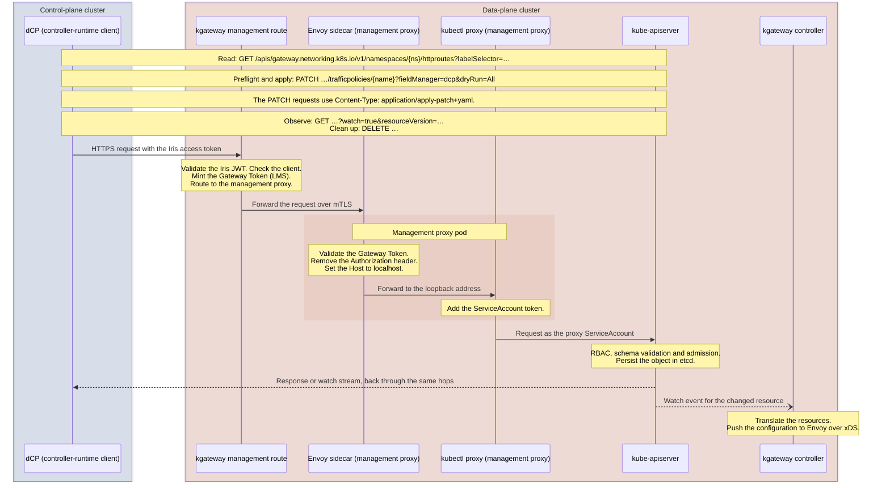

# Reuse an Existing Kubernetes API Proxy before Building One

## Context and Problem Statement

[ADR 0004](0004-use-an-oauth-proxy-for-cross-cluster-configuration.md) proposes a transparent Kubernetes API proxy with
OAuth authentication for machine clients. The dCP owns route semantics and reconciliation. Kubernetes owns resource
validation and persistence. We need a component for authentication and forwarding, not another route-management service.

Should we configure existing open-source software or build a dedicated service? In this record, "buy" means that we
reuse and operate an existing component. We will not use a commercial product.

## Decision Drivers

- Reuse Kubernetes API semantics and existing clients, including list/watch and server-side apply.
- Accept OAuth2 client-credentials access tokens from the required issuer. Authorize the calling client.
- Keep a Kubernetes credential with a narrow scope and regular rotation inside the target cluster.
- Keep custom code, dependencies and long-term maintenance to a minimum.

## Considered Options

- Configure an existing reverse proxy that can authenticate requests. If necessary, add a local forwarder with a
  Kubernetes credential.
- Adopt a dedicated Kubernetes identity proxy or a broader cluster-management platform.
- Build a small Go forwarding service.
- Build a route-specific operation API, or use a workflow or GitOps controller.
- Add mTLS client certificates to the OAuth access token on the path from the dCP. The internal wiki page
  [Cross-cluster Configuration][security-wiki] assesses this option.

## Decision Outcome

Proposed option: **reuse an existing proxy or a small composition of proxies**. Select a product after integration
tests. The tests must show the required behavior for the issuer, the Kubernetes client and credential rotation. This
record does not select a product yet.

A custom route API adds validation and lifecycle responsibilities. ADR 0004 gives these responsibilities to other
layers. Workflow and GitOps controllers add execution or desired-state machinery, but they do not solve a requirement of
this proxy. A broader management platform is a good choice only if we already operate it and it supplies the required
boundary at low cost.

### Candidates

| Candidate | Fit according to the sources, and remaining work |
| --- | --- |
| Existing kgateway with `kubectl proxy` | Reuses the existing Envoy front end. kgateway v2.3.0 exposes [JWT providers][kgateway-extensions] and [JWT and CEL-RBAC policies][kgateway-policies]. Bootstrap the management route independently of the dCP. Test the actual issuer, authorization, forwarding and the shared failure domain. |
| Envoy sidecar with local `kubectl proxy` (_preferred_) | Adds an authentication check in the management proxy pod, behind the kgateway route. Envoy provides [JWT verification][envoy-jwt] and [HTTP RBAC][envoy-rbac] for the verified client claim. `kubectl proxy` supplies [Kubernetes forwarding][kubectl-proxy], and client-go supplies [token-file refresh][token-file]. Test the composition and watch streaming. |
| Ory Oathkeeper with local `kubectl proxy` | Alternative with [JWT][oathkeeper-jwt] or [OAuth2 introspection][oathkeeper-introspection]. Add an explicit rule for authorized clients, because authentication alone is not sufficient. Test the removal of credential headers and the watch behavior. |
| Envoy alone | [Credential injection][envoy-injector] can replace the upstream bearer header. The extension is [alpha][envoy-extensions]. The [SDS file-rotation documentation][envoy-sds] does not show that a filename-backed GenericSecret refreshes a projected token automatically. Before selection, demonstrate a refresh mechanism. |
| kube-oidc-proxy | The [Jetstack original is archived][kube-oidc-proxy]. A fork from Tremolo Security exists. Its OIDC and impersonation model would change the identity model of ADR 0004. It also needs scoped impersonation permissions. It is an alternative to the current model, not a matching candidate. |

In all candidates, kgateway routes the management traffic to the management proxy. An authentication component in the
management proxy pod, for example Envoy or Oathkeeper, only checks the request and forwards it to its one local
upstream. It does not route.

The diagram shows the path of one Kubernetes API call through the preferred candidate. kgateway routes the call. The
Envoy sidecar only checks the request.

The management route runs on the same kgateway as the routes that the dCP generates. So management access depends on
that configuration and shares rollout and configuration failures with the gateway. If management access fails, the dCP
cannot repair it. The platform deployment bootstraps and recovers the management route without the dCP. See
[Bootstrap the management route with the platform deployment](#bootstrap-the-management-route-with-the-platform-deployment).

The [management proxy guide](../developer/management-proxy.md) describes the implementation of the preferred candidate
and the results of a proof of concept.

The pinned sources show the building blocks. A candidate stays unverified until it passes the checks in
[Evidence required for product selection](#evidence-required-for-product-selection).

### Bootstrap the management route with the platform deployment

Each component of the composition ships in the gateway chart. A candidate that needs a cluster operator, a DaemonSet
with host access or other cluster-wide tooling does not qualify. The gateway chart itself already needs cluster-wide
resources, for example the CRDs, the GatewayClass and the ClusterRoles of kgateway. Agree on this footprint with each
cluster operator. Prerequisites that the gateway runtime already has, for example the certificate issuer behind the key
rotator, stay allowed.

The
[management proxy guide](../developer/management-proxy.md#bootstrap-the-management-route-with-the-platform-deployment)
describes the bootstrap with Argo CD sync waves.

### Protect the management proxy from in-cluster access

`kubectl proxy` has no authentication. The [Kubernetes documentation][kubectl-proxy-warning] warns about this. Policies
on the management HTTPRoute run only in the kgateway proxy. A pod that calls the management proxy Service directly skips
them. So the management proxy authenticates each request itself.

Proposed: **the Envoy sidecar checks the LMS Gateway Token** that kgateway mints for the management route. kgateway
authenticates to the sidecar with a client certificate from a [BackendConfigPolicy][kgateway-backend-tls]. cert-manager
issues and renews the TLS certificate of the sidecar and the client certificate of kgateway. The gateway runtime already
uses cert-manager for the source certificates of the key rotator. Verify that each target cluster provides it.

The internal wiki page [Cross-cluster Configuration][security-wiki] compares the token options. It also lists the risk
measures and the hardening of the management proxy.

The [management proxy guide](../developer/management-proxy.md#configure-the-envoy-sidecar) shows the configuration of
the sidecar.

### Identity-model change for kube-oidc-proxy

In the current proposal, Kubernetes authenticates and authorizes every forwarded request as the local ServiceAccount.
The OAuth front end decides which external client can use that execution identity.

In [Tremolo kube-oidc-proxy v1.0.12][oidc-impersonation], the proxy validates the JWT. It maps the username claim and
the optional group claims to Kubernetes subjects. It authenticates upstream with its local credentials and sends
impersonation headers. Kubernetes first authorizes the proxy to impersonate those subjects. Then Kubernetes authorizes
the requested operation as the mapped user or group. For this normal proxy flow, the API server does not need to trust
the external issuer.

This changes the [RBAC ownership and impersonation permissions][kubernetes-impersonation]:

- Give the proxy ServiceAccount cluster-scoped `impersonate` permissions. Limit them with an allowlist of the mapped
  users and groups. Kubernetes has no namespace-scoped permission for ordinary user or group impersonation.
- Bind namespace-scoped resource permissions to the mapped user or group, not to the proxy ServiceAccount. You do not
  create a Kubernetes User object. A RoleBinding refers to the mapped subject name.
- Kubernetes audit records can keep both the authenticated proxy identity and the impersonated caller identity.

A machine-client JWT can work if it has a suitable stable claim and an accepted issuer and audience. Browser login is
not necessary. Verify this with an actual token. [Token passthrough][oidc-passthrough] is different. It forwards the
original token, and the API server must accept that token. If you disable impersonation, you do not get the model with a
fixed ServiceAccount. If we select kube-oidc-proxy, explicit impersonation allowlists and RBAC for the effective user
replace the no-impersonation rule below. The broad default permissions of its chart are not the proposed permission
scope.

### Evidence required for product selection

1. Authenticate an actual access token of a machine client. Reject invalid tokens. Reject clients that are authenticated
   but not authorized.
2. Keep the local credentials private. Refresh them when the projected ServiceAccount token rotates. Verify upstream
   TLS. Remove caller credentials and impersonation headers before the proxy forwards the request with the local
   identity. Do not give impersonation permissions to the ServiceAccount.
3. Use a Kubernetes client for permitted discovery, list/watch, apply with `dryRun=All`, real apply and delete. Verify
   the handling of the forwarded host. Keep Kubernetes status and error bodies, query options and patch content types
   unchanged. Make sure that RBAC denies resources, namespaces and verbs that are not allowed.
4. Reconnect watches after a connection loss and after expired resource versions. Verify that new requests use the
   refreshed token. Verify that the dCP repairs missed drift. The proxy validates the JWT when a request starts. An
   existing watch does not have to close when the token expires. Select and test a maximum stream duration and timeouts
   that are compatible with streaming. Make sure that the proxy does not buffer streams and does not retry mutations.
5. Expose metrics for requests, errors and latency. Verify that the logs are useful and do not contain tokens,
   authorization headers or secrets from payloads.
6. Bootstrap the management route while the dCP is unavailable. Recover a broken management route through the platform
   deployment path. Verify that a partial bootstrap never exposes an unauthenticated Kubernetes proxy. Verify that the
   management proxy has no direct exposure. Verify that the bootstrap resources are outside the write scope of the
   caller.
7. From a pod in another namespace and from a pod in the management proxy namespace, call its Service and the pod IP
   without a token and with a valid token of a client that is not authorized. Make sure that no request reaches
   `kubectl proxy`.

A proof of concept of the preferred candidate covers parts of items 1, 2, 3, 4 and 7. See
[the management proxy guide](../developer/management-proxy.md#results-of-the-proof-of-concept).

Gateway readiness and safe intermediate traffic configuration stay integration topics for the dCP and kgateway under ADR
0004.

### When building is justified

Build only if the integration tests find a specific gap. Building must cost less than configuring or extending existing
software. Include the maintenance in this cost. If we need a fallback, make it a Go forwarding service with standard
Kubernetes client machinery. Document an OpenAPI contract for all endpoints that the service adds. Do not add route
bundles, translation or reconciliation only because a custom process exists.

### Consequences

We still own the deployment configuration, RBAC, the issuer integration and the kgateway FeatureBuilder of the dCP.
Reuse of a proxy removes custom API behavior, but not this integration work. We can change the product without a change
to the split of responsibilities in ADR 0004.

## More Information

- [Kubernetes dry run and watch semantics](https://kubernetes.io/docs/reference/using-api/api-concepts/)
- [Tremolo Security kube-oidc-proxy fork](https://github.com/TremoloSecurity/kube-oidc-proxy)

[envoy-jwt]: https://github.com/envoyproxy/envoy/blob/6bf4e1821bb9f27e30617ea83709a148ccc025e6/docs/root/configuration/http/http_filters/jwt_authn_filter.rst
[envoy-rbac]: https://github.com/envoyproxy/envoy/blob/6bf4e1821bb9f27e30617ea83709a148ccc025e6/docs/root/configuration/http/http_filters/rbac_filter.rst
[kubectl-proxy]: https://github.com/kubernetes/kubectl/blob/62644851425759e5f7b4916b5bff65e829cfbc25/pkg/proxy/proxy_server.go
[kubectl-proxy-warning]: https://kubernetes.io/docs/reference/kubectl/conventions/#kubectl-proxy
[security-wiki]: https://wiki.telekom.de/spaces/DHEI/pages/4600044528/Cross-cluster+Configuration
[kgateway-backend-tls]: https://github.com/kgateway-dev/kgateway/blob/v2.3.0/api/v1alpha1/kgateway/backend_config_policy_types.go#L288-L339
[token-file]: https://github.com/kubernetes/kubernetes/blob/d9e352346bb8aaf71fc86f956236fcd9806e8c5f/staging/src/k8s.io/client-go/transport/round_trippers.go
[oathkeeper-jwt]: https://github.com/ory/oathkeeper/blob/ab46001dc7d772710066c544aeb4e1a4f78e5f6f/pipeline/authn/authenticator_jwt.go
[oathkeeper-introspection]: https://github.com/ory/oathkeeper/blob/ab46001dc7d772710066c544aeb4e1a4f78e5f6f/pipeline/authn/authenticator_oauth2_introspection.go
[envoy-injector]: https://github.com/envoyproxy/envoy/blob/6bf4e1821bb9f27e30617ea83709a148ccc025e6/api/envoy/extensions/filters/http/credential_injector/v3/credential_injector.proto
[envoy-extensions]: https://github.com/envoyproxy/envoy/blob/6bf4e1821bb9f27e30617ea83709a148ccc025e6/source/extensions/extensions_metadata.yaml
[envoy-sds]: https://github.com/envoyproxy/envoy/blob/6bf4e1821bb9f27e30617ea83709a148ccc025e6/docs/root/configuration/security/secret.rst
[kube-oidc-proxy]: https://github.com/jetstack/kube-oidc-proxy/blob/6ed44b437a43ec17b4ce9eb56aebd264029bab44/README.md
[kgateway-extensions]: https://github.com/kgateway-dev/kgateway/blob/v2.3.0/install/helm/kgateway-crds/templates/gateway.kgateway.dev_gatewayextensions.yaml
[kgateway-policies]: https://github.com/kgateway-dev/kgateway/blob/v2.3.0/install/helm/kgateway-crds/templates/gateway.kgateway.dev_trafficpolicies.yaml
[oidc-impersonation]: https://github.com/TremoloSecurity/kube-oidc-proxy/blob/63bfef0eeeb0d71ba55c597972a3c93d3f606c8a/pkg/proxy/proxy.go#L218-L239
[oidc-passthrough]: https://github.com/TremoloSecurity/kube-oidc-proxy/blob/63bfef0eeeb0d71ba55c597972a3c93d3f606c8a/docs/tasks/token-passthrough.md
[kubernetes-impersonation]: https://github.com/kubernetes/website/blob/3793b2f6cd0256224839b064ede8dcee9fd5ee20/content/en/docs/reference/access-authn-authz/user-impersonation.md
