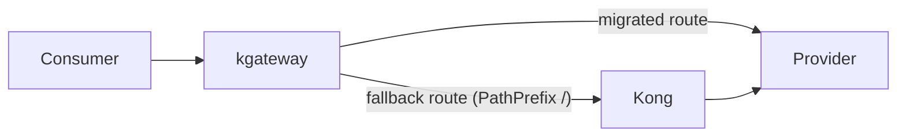

# Migrate Zones to kgateway with Kong as Fallback

## Context and Problem Statement

The new gateway on kgateway replaces the Kong-based gateway. Each zone has a gateway on its own data plane. A zone
operator operates it. Today, an ingress controller receives the traffic of a zone and sends it to Kong. Kong sends it to
the providers. The [control plane](https://github.com/telekom/controlplane) configures Kong through the Kong admin API.

At first, kgateway will not support all features of the current gateway. A route can only move to kgateway when kgateway
supports all features that the route uses.

How do we move the traffic of a zone from Kong to kgateway?

## Decision Drivers

- **No change for consumers and providers.** Hostnames, paths and tokens stay the same.
- **Move routes one by one.** A route moves when kgateway supports all its features.
- **Fast rollback.** We can roll back one route or a whole zone without a DNS change.
- **Test before go-live.** We can test a kgateway route on the real hostname before consumer traffic uses it.
- **Zone operators can do it.** The procedure works on each data plane, with steps that a zone operator can follow.
- **Short transition.** Keep the time with two gateways and two configurations short.
- **Failure isolation and clear status.** A kgateway failure does not change Kong readiness or block consumers.
- **Least privilege and independent delivery.** Kong credentials stay in the Kong operator; kgateway changes do not
  change its binary.
- **Small contract change.** Prefer no changes to the shared `Route` schema used by other domains.

A big-bang migration per zone and a new hostname for kgateway do not meet the first two drivers. We rejected them early.

## Considered Options

- kgateway replaces the ingress controller, Kong as fallback for `/`
- Kong stays behind the ingress controller, kgateway behind Kong
- Weighted traffic split between the two gateways at the load balancer or in DNS
- Replace Kong with kgateway for all routes in a zone at once

## Decision Outcome

**Proposed migration approach:** kgateway replaces the ingress controller, with Kong as fallback for `/`. This allows
routes to move one by one and puts kgateway into the request path before any route moves. This record remains proposed.
It does not decide the control plane Route and operator architecture: options A and D remain under consideration.
The [configuration location](#zone-configuration) also remains open; the recommendation below is for discussion.

kgateway takes over the role of the ingress controller for the API traffic of the zone. It is not an additional hop:
requests pass kgateway and Kong, as they pass the ingress controller and Kong today. After the ingress moves, kgateway
receives all API traffic of the zone. A catch-all `HTTPRoute` for `PathPrefix /`, the fallback route, sends all
requests to Kong. Eligible API traffic is routed directly to the provider by a more-specific kgateway route; all other
requests go through Kong as before. How the control plane represents and reconciles these routes remains open; see
[Route and operator architecture](#route-and-operator-architecture).



### Consequences

- Good, because consumers and providers see no change.
- Good, because kgateway replaces the ingress controller before any route moves. At that time, kgateway only forwards to
  Kong, as the ingress controller does today.
- Good, because a route goes live or rolls back with a change in the control plane only.
- Good, because the number of hops does not grow. Requests on migrated routes skip Kong and pass one proxy less than
  today.
- Bad, because the control plane configures two gateways at the same time. It must expose the independent status of each
  gateway's Routes.
- Bad, because the client IP setup of Kong expects the ingress controller in front. Zones must change it, see
  [Client IP in Kong](#client-ip-in-kong).

## Implementation Sketch

### Rollout per zone

The steps use the test header, see [Per-route switch](#per-route-switch).

1. Deploy kgateway on the data plane of the zone. Check connectivity and observability. The ingress controller still
   sends all traffic to Kong.
2. Give the control plane access to the data plane. The control plane runs in another cluster, see
   [pull request #3](https://github.com/telekom/gateway/pull/3) ("Configure Data-Plane Resources through an
   OAuth-Protected Kubernetes API Proxy" and "Reuse an Existing Kubernetes API Proxy before Building One").
3. Turn on the fallback route in the chart. It points to the cluster-internal Service of the Kong proxy.
4. Add kgateway to the zone configuration in the control plane. The control plane creates kgateway routes in test mode.
   Kong stays fully configured.
5. Test the fallback route. Call the kgateway Service directly with the `Host` header of the zone and a valid consumer
   token.
6. Let kgateway replace the ingress controller for the Kong proxy, see [Open Questions](#open-questions). The ingress of
   the Kong admin API stays. Before that, change the client IP setup of Kong, see
   [Client IP in Kong](#client-ip-in-kong).
7. Smoke-test one route on the real hostname with the test header.
8. Make the routes go live one by one. To roll back a route, put it back into test mode.
9. When all routes are live, check that the fallback route gets no traffic. Then turn it off.
10. Remove Kong from the zone configuration. The control plane stops configuring Kong. Remove the Kong deployment.

### Fallback route

The chart creates the fallback route from these values:

```yaml
kongFallback:
  enabled: false
  service:
    name: my-kong-service
    namespace: kong # empty: namespace of the release
    port: 8000
  hostnames: # the hostnames of the zone, the same as on the routes of the control plane
    - api.example.com
  timeouts:
    request: 0s # 0s turns the timeout off. Kong applies its own timeouts.
```

```yaml
apiVersion: gateway.networking.k8s.io/v1
kind: HTTPRoute
metadata:
  name: kong-fallback
spec:
  parentRefs:
    - name: my-gateway
  hostnames:
    - api.example.com
  rules:
    - matches:
        - path:
            type: PathPrefix
            value: /
      backendRefs:
        - name: my-kong-service
          namespace: kong
          port: 8000
      timeouts:
        request: 0s
```

- **Hostnames.** The fallback route uses the same hostnames as the routes of the control plane. Gateway API compares
  hostnames before paths. kgateway creates one Envoy virtual host per hostname, and Envoy selects one virtual host per
  request. A fallback route without hostnames is only in the virtual host `*`. Requests to `api.example.com` on a path
  without a kgateway route then get a 404.
- **Timeout.** Without a timeout, Envoy uses 15 seconds. Kong uses 60 seconds by default. The fallback route turns the
  timeout off, so that Kong applies its own timeouts.
- **Namespace.** If Kong runs in another namespace, the reference needs a `ReferenceGrant` in the namespace of Kong.
- **Policies.** The fallback route has no policies. Policies that target the whole `Gateway` also apply to it. They must
  not change requests that go to Kong.
- **Nested paths.** The control plane blocks only API base paths that are exactly the same. If `/a/v1` is live on
  kgateway, it also catches requests to a nested base path like `/a/v1/b/v1`, which belong to Kong. Such nested base
  paths do not occur in practice, so they are not a risk.

### Route and zone switches

The control plane needs a way to move traffic from Kong to kgateway. It creates kgateway resources only for routes
whose features kgateway supports. These are possible ways to control when traffic uses those resources:

- **Test header (preferred).** The control plane always creates the kgateway resources of supported routes. While the
  switch is off, the route is in test mode: its `HTTPRoute` rule has an extra header match, for example
  `x-kgateway-test: "true"`. Requests without the header do not match and go to Kong. When the switch is on, the control
  plane removes the header match.
  - Good, because we can test a route on the real hostname before go-live.
  - Good, because kgateway accepts all resources of the route before go-live. Go-live changes one match only.
  - Bad, because each client that sends the header reaches the kgateway route before go-live. Only gateway operators and
    developers know the header, and kgateway already checks authentication and access. Policies that kgateway does not
    support yet, for example rate limiting, do not apply. We accept this risk.
- **Selected test routes.** A CRD or an annotation in the control plane selects specific routes for tests. The control
  plane creates kgateway resources in test mode only for these routes. Other routes have no kgateway resources until
  their switch is on.
  - Good, because we can test the selected routes before go-live.
  - Good, because fewer routes are reachable with the test header.
  - Bad, because zone operators have no access to the control plane. We must select the test routes for them centrally.
  - Bad, because kgateway does not accept the resources of the other routes before their go-live.
- **Create on switch.** The control plane creates the kgateway resources only when the switch is on.
  - Good, because it is simple and there are no hidden routes.
  - Bad, because we cannot test a route before go-live.
- **Feature-based switch.** Use a feature to express whether kgateway-native routing is enabled. The feature's exact
  semantics, where it is configured, and its interaction with any per-route rollout remain open.

For a rollback of the whole zone, the control plane puts all routes into test mode (test header), removes them
(selected test routes or create on switch), or turns off the feature-based switch.

A zone can also switch completely to kgateway at once by changing its default API preset to the Kgateway gateway and
stopping Kong configuration. This is the end-state cutover, not a per-route switch: it requires all routes and
required gateway behavior to be ready on kgateway, and does not provide a gradual route-by-route rollout.

### Route and operator architecture

- **A: Two Routes, two gateway operators (current implementation).** The API operator creates a Kong route and, when
  eligible, a separate kgateway route. Each operator owns its route and configures its gateway. This isolates gateway
  failures and credentials, avoids changes to the shared route contract, and leaves the Kong operator independent.
  Costs include an additional route and operator, deployment ordering, and API-domain-only support unless other
  domain operators add equivalent behavior.

  ```mermaid
  flowchart LR
      api[API operator] --> kr["Route for Kong"]
      api --> gr["Route for kgateway"]
      kr --> ko["Kong operator"] --> kong[Kong]
      gr --> go["kgateway operator"] --> kgateway[kgateway]
  ```

- **B: Two Routes, one gateway operator.** Use the same two-route model as A, but have one operator configure both
  gateways. This saves a deployment and shares reconciliation infrastructure, but gateway failures, workload and
  credentials share a process. Changes for kgateway also change the Kong operator binary; support remains limited to
  domains that create the separate kgateway route.

  ```mermaid
  flowchart LR
      api[API operator] --> kr["Route for Kong"]
      api --> gr["Route for kgateway"]
      kr --> operator["Gateway operator"]
      gr --> operator
      operator --> kong[Kong]
      operator --> kgateway[kgateway]
  ```

- **C: One Route, one gateway operator.** A single route represents both gateway targets and one operator configures
  both. This avoids duplicate routes but couples their readiness and cleanup: a kgateway failure can affect the shared
  route's status and consumers even while Kong is serving. It also requires changes to the shared route contract and
  domain operators.

  ```mermaid
  flowchart LR
      api[Domain operators] --> route["Shared Route"]
      route --> operator["Gateway operator"]
      operator --> kong[Kong]
      operator --> kgateway[kgateway]
  ```

- **D: One Route, one operator with two controllers.** Domain operators create one route as usual. The operator
  contains separate Kong and kgateway controllers that reconcile the route and own independent status and cleanup.
  This avoids duplicate routes and can make routes from multiple domains eligible without domain-specific changes. It
  requires support for independent controller ownership in the shared controller framework. The controllers share
  the operator's process and credentials; separate deployments can mitigate that at the cost of deployment and
  release complexity.

  ```mermaid
  flowchart LR
      domain[Domain operators] --> route["Shared Route"]
      subgraph operator["Gateway operator"]
          kongController["Kong Route controller"]
          kgatewayController["kgateway Route controller"]
      end
      route --> kongController --> kong[Kong]
      route --> kgatewayController --> kgateway[kgateway]
  ```

This record does not choose between options A and D. Option A is the current implementation, while option D remains
an alternative; whether to keep A or move to D is open. D's key benefit is selection in the gateway layer, not merely
putting two gateway implementations in one process. Its selection must derive consumer features from `ConsumeRoute`
and gateway Consumers using the shared `detect` package, guard admin, proxy and failover Routes, and define
hostname/path behavior for non-API domains.

### End-state migration

The coexistence logic is temporary. Under option A, move each zone to the kgateway-only configuration before removing
it:

1. Support all features used by the zone's APIs and set the kgateway gateway to `mode: All`.
2. Lift the kgateway preset restrictions and point the default API preset at the Kgateway gateway. The API operator's
   ordinary Route becomes the kgateway Route; the prefixed sibling Route is removed and the data-plane objects are
   recreated.
3. Make identity and zone-health routes work on kgateway before removing the catch-all route to Kong.
4. After every zone has moved, remove coexistence-only code for option A: sibling Route creation and selection in the
   API operator, kgateway preset restrictions, routing-mode fields, match-header annotations and fallback
   configuration.
5. After no zone uses Kong, remove the Kong operator module and Kong-only CRD fields and admin-operator branches.
   Keep generic feature detection, `supportedFeatures`, `CleanupStaleRoutes`, the kgateway operator and Krudy client.

During the coexistence phase, switching a zone off uses `exclude.basePaths: ["/*"]`; do not remove its Kgateway gateway
entry or preset. Gateway entries are permanent and must be referenced by a preset. `ApiExposure.status.route` and
`ConsumeRoute` already reference the ordinary Route, so after the switch they continue to reference the Route served by
kgateway.

## Zone configuration

The migration needs both permanent gateway configuration and temporary rollout settings. They do not all need the
same home. In particular, a gateway's capabilities describe what it can enforce; a rollout switch describes whether
traffic should use it. Enabling rollout must not, by itself, declare a feature supported.

The existing Zone model already separates gateway connections (`gateways[]`) from traffic presets (`presets[]`).
[ADR 0001](0001-dcp-kgateway-route-architecture.md#zone-and-gateway-changes) and the
[implementation plan](../../plans/active/DHEI-21832-dcp-kgateway-route-opt-in.md#c2-zone-configuration-kgateway-gateway-and-kgateway-preset)
describe a working model with migration fields on `Zone.spec.gateways[]`. That is the implementation baseline, not
a settled configuration decision in this record. The field names below refer to that model; alternative locations
and any new resource names are proposals, not an agreed schema.

### Configuration inventory and ownership

| Configuration | Scope and purpose | Writer and readers | After migration |
|---|---|---|---|
| `implementation`, admin endpoint and TLS trust | One gateway instance and its connection | Platform configuration; admin operator projects it to the gateway-domain `Gateway`, gateway operators read it | Keep |
| `supportedFeatures` | Capabilities enabled for one deployed gateway instance, not the features an API requests | Platform configuration; route-selection controller and gateway operator safety checks read it | Keep while capability checks are needed |
| `mode`, `matchHeader` | Rollout and test behavior for the target gateway in a zone | Authorized migration operator through the platform configuration workflow; selection controller reads it | Remove coexistence-only settings |
| Route selection and exceptions, such as `exclude.basePaths` | Which APIs stay on Kong, go to test, or go live; the exact switch mechanism remains open | Authorized migration operator; selection controller reads it | Remove coexistence-only settings |
| Preset `gatewayRef`, hostnames and base paths | Which gateway serves a traffic type and under which URLs | Platform configuration; admin and domain operators read it | Keep |
| Effective route target and header match | Result of selection for an individual Route | Selection controller writes it; gateway operator reads it | Keep only the ordinary routing contract |
| Fallback Service, fallback hostnames, listeners, load balancer and Kong client-IP trust | Data-plane deployment and ingress wiring | Zone operator through Helm/GitOps; chart and data-plane controllers apply it | Remove fallback and Kong-only settings |
| Credentials and private key material | Access to gateway admin endpoints and signing | Existing secret-management workflow; authorized runtime components read it | Keep as needed; do not copy into rollout policy |

The gateway-domain `Gateway` here is a control-plane resource, not the Kubernetes Gateway API `Gateway` on the data
plane. An operator-written projection is not a second source of truth. Similarly, Route labels, annotations and
data-plane `HTTPRoute` matches are generated results, not places for manual rollout edits.

### Location options

The options compare the authoritative home of migration settings. Permanent connection settings and preset URLs
can stay in their existing locations in every option.

#### Configuration option 1: A migration block on the Zone

Add a typed block such as `Zone.spec.gatewayMigration` with a target gateway reference, mode, test header and route
selection. Keep gateway capabilities on the gateway entry and URLs on presets.

- Good, because one object shows the whole zone's migration and supports one zone-wide rollback edit.
- Good, because it separates temporary migration policy from permanent gateway configuration.
- Bad, because a zone-wide block needs explicit source and target references if there are several gateways or
  migration pairs; it must not assume that every traffic type moves together.
- Bad, because migration and unrelated zone administration share one object and its write permissions.
- Bad, because selection controllers depend on the admin Zone and its change propagation.

#### Configuration option 2: On the gateway entry in the Zone

Use `Zone.spec.gateways[]` for `supportedFeatures`, `mode`, `matchHeader` and `exclude`, as in the working model.
The admin operator projects only the fields needed by gateway-domain operators to their `Gateway` resources.

**Example: Zone configuration (source of truth).** These are illustrative excerpts, not complete apply-ready
manifests. The Zone's existing identity-provider configuration and the generated Gateway's admin authentication
fields are omitted. The feature list must reflect the capabilities enabled on the deployed gateway.

```yaml
apiVersion: admin.cp.ei.telekom.de/v1
kind: Zone
metadata:
  name: zone-a
  namespace: dev
spec:
  gateways:
    - name: kong
      implementation: Kong
      admin:
        identityProviderRef: primary
        url: https://kong-admin.example.com
    - name: kgateway
      implementation: Kgateway
      admin:
        identityProviderRef: primary
        url: https://krudy.example.com
      supportedFeatures:
        - PassThrough
        - LastMileSecurity
      mode: Selective
      matchHeader:
        name: x-kgateway-test
        value: "true"
      exclude:
        basePaths:
          - /billing/v1
          - /payments/*
  presets:
    - name: default
      type: API
      default: true
      gatewayRef: kong
      identityProviderRef: primary
      urls:
        - hostname: api.example.com
          basePath: /
    - name: kgateway
      type: API
      default: false
      gatewayRef: kgateway
      identityProviderRef: primary
      urls:
        - hostname: api.example.com
          basePath: /
```

The Kong preset stays the default during coexistence. The kgateway preset uses the same public hostname so that
test and migrated requests keep the consumer-facing URL.

**Example: generated gateway-domain Gateway (projection, not edited manually).**

```yaml
apiVersion: gateway.cp.ei.telekom.de/v1
kind: Gateway
metadata:
  name: zone-a-kgateway
  namespace: dev--zone-a
spec:
  implementation: Kgateway
  supportedFeatures:
    - PassThrough
    - LastMileSecurity
  admin:
    url: https://krudy.example.com
```

The admin operator copies `implementation` and `supportedFeatures`, alongside the existing connection configuration.
`mode`, `matchHeader` and `exclude` stay on the Zone for the route-selection controller; they are not fields on the
generated Gateway in this working model. Rollout changes therefore edit the Zone, not the generated Gateway.

- Good, because settings are next to the gateway they describe, with no additional resource or reference.
- Good, because it follows the existing Zone-to-Gateway flow. Gateway operators can read their own Gateway without
  access to the admin Zone.
- Good, because it is the smallest change from the working model and works with architecture option A.
- Bad, because permanent capabilities and temporary rollout settings share the gateway entry; cleanup must remove
  the latter without removing the gateway.
- Bad, because a gateway shared by several presets gets one rollout policy unless additional scoping is introduced.
- Bad, because domain-side selection requires Zone access. Moving selection into the gateway layer under architecture
  option D would also require projecting the rollout settings, or referencing a separate policy.

#### Configuration option 3: On the preset in the Zone

Put a typed migration block on `Zone.spec.presets[]`; each preset selects its target gateway and rollout behavior.
Keep `supportedFeatures` on the gateway entry, because capabilities describe the deployed gateway, not its URLs.
A feature flag could enable direct routing, but cannot alone represent a header, route selectors and rollback rules.

- Good, because rollout can differ by traffic type, hostname or base-path group even when presets share a gateway.
- Good, because domain operators already use presets to select their gateway and URLs.
- Bad, because the same gateway's rollout settings can be repeated or conflict across presets.
- Bad, because changing the default preset is an end-state cutover, not a substitute for per-route rollout.
- Bad, because preset selection must not accidentally send ordinary routes or consumers to the migration-only preset.
  This still couples selection to the admin model.

#### Configuration option 4: Make the gateway-domain Gateway authoritative

Manage capability and rollout settings directly on the control-plane `Gateway`, rather than treating those fields as
an admin-owned projection. The Zone would reference the gateway or stop projecting the independently managed fields.

- Good, because gateway-layer selection and safety checks can read configuration without an admin Zone dependency.
- Good, because the resource describes a single gateway instance and could support routes from several domains.
- Bad, because the existing admin reconciliation owns the Gateway. Direct edits would be overwritten unless ownership
  and reconciliation are changed explicitly.
- Bad, because operators would need a new supported configuration workflow; writing this resource is not currently a
  substitute for Zone administration.
- Bad, because putting policy next to admin connection configuration does not automatically provide safe delegated
  access. Schema changes and field ownership must keep connection credentials outside rollout permissions.

#### Configuration option 5: A dedicated migration-policy resource

Introduce a typed resource, for example `GatewayMigrationPolicy`, that references a zone and target gateway and owns
only rollout mode, test matching and route selection. Keep capabilities and connections on gateway configuration.
The controller that makes the selection watches this policy.

- Good, because temporary rollout policy has its own lifecycle, validation and status, separate from the Zone and
  gateway connection.
- Good, because resource-level RBAC can delegate rollout changes without granting edits to the whole Zone or Gateway.
- Good, because one policy can support gateway-layer selection across domains under architecture option D.
- Bad, because it adds a CRD, references, watches, permissions and deployment ordering for temporary migration logic.
- Bad, because overlapping policies need conflict rules; a simple first version should allow only one policy per
  target gateway and zone.
- Bad, because a new resource does not give zone operators control-plane access. A GitOps or API workflow and its
  authorization still need to be provided.

#### Configuration option 6: On each API exposure or Route

Store test/live/disabled intent on the source API exposure, or on a shared route-level policy if several domains must
participate. An annotation is possible, but needs defined validation and ownership. Do not manually edit generated
Routes.

- Good, because rollout intent is next to the affected API and individual pilots are easy to identify.
- Good, because it avoids a growing central list of base paths.
- Bad, because API owners could affect platform migration unless rollout permissions are explicitly restricted.
- Bad, because a zone-wide rollback needs many edits or a higher-level override, which introduces another policy
  layer and precedence rules.
- Bad, because API-exposure fields do not cover other domains, while shared Route changes affect all Route producers.
  Gateway capability configuration still needs another home.

### Proposed direction, not a decision

**Prefer configuration option 2 for the current migration**, with a clear distinction between permanent capabilities
and temporary rollout settings. It reuses the working model and avoids another resource for a short transition.
Keep preset URLs in `presets[]`, infrastructure in the chart, and secrets in the existing secret-management workflow.
Helm values and operator environment variables should not be a second source of route-selection policy: that would
split the control plane's desired state from the configuration used to render routes.

**Prefer configuration option 5 instead if independently delegated rollout ownership is required**, or if migration
policy must span several domains and gateway instances. Configuration option 1 is a simpler alternative when there
is exactly one zone-wide migration pair. Preset-scoped rollout is justified only if presets need genuinely different
policies; per-API settings should not be the only mechanism for a zone rollback.

Configuration location does not choose between architecture options A and D. With A, the API operator consumes the
selection policy. With D, the gateway-layer controller needs that policy and consumer-feature information without
making domain operators create sibling Routes. Each design must define how changes requeue every affected route.

Whichever location is chosen:

- Define one authoritative writer for each field. Project required values into generated resources; do not allow
  competing manual settings on both Zone and Gateway.
- Preserve existing Kong behavior when migration configuration is absent. Reject invalid or conflicting settings and
  report blocked reconciliation instead of interpreting them as permission to move traffic.
- Separate feature eligibility from operator rollout intent. If a mode intentionally skips feature checks, document it
  as an explicit cutover choice, not as evidence that those features are supported.
- Define selection precedence and zone rollback behavior for the chosen switch mechanism. Distinguish keeping a route
  in test mode from excluding it entirely; exclusions and a zone rollback must override per-route go-live choices.
- Report the effective selection, its reason and the applied configuration generation. Do not promote a route before
  the gateway has accepted its required configuration; preserve independent Kong and kgateway readiness.
- Treat the test header as a routing selector, not authorization or a secret. Its accepted exposure is described under
  [Route and zone switches](#route-and-zone-switches).
- Provide an authorized GitOps or API workflow for zone operators; a new field or CRD alone does not grant them
  control-plane access.

The remaining decision is whether rollout is owned centrally with Zone administration or delegated independently,
and whether one target-gateway policy is sufficient or preset/domain-specific policies are required. Those answers
determine whether the simplicity of option 2 outweighs the separation offered by option 5.

## Pros and Cons of the Options

### kgateway replaces the ingress controller, Kong as fallback for `/`

- Good, because routes move one by one.
- Good, because kgateway replaces the ingress controller early, with no change in behavior.
- Good, because migrated routes pass one proxy only. Routes that did not move pass two proxies, as today.
- Bad, because the control plane configures two gateways until all routes have moved.

### Kong stays behind the ingress controller, kgateway behind Kong

The control plane changes the upstream of a migrated Kong route to kgateway.

- Good, because routes move one by one.
- Good, because the ingress controller stays during the migration.
- Bad, because migrated routes pass three proxies (ingress controller, Kong and kgateway) until Kong is removed.
- Bad, because kgateway replaces the ingress controller at the end, for all routes at once.
- Bad, because the Kong route of a migrated route must forward without its own policies. This adds a third kind of Kong
  configuration.

### Weighted traffic split between the two gateways at the load balancer or in DNS

- Good, because a percentage of the traffic tests kgateway first.
- Bad, because kgateway must support all routes of the zone before it gets any traffic.
- Bad, because there is no control per route.
- Bad, because DNS caches make a rollback slow.

### Replace Kong with kgateway for all routes in a zone at once

The control plane changes the zone's default API preset to target kgateway and stops configuring Kong.

- Good, because the zone has one gateway implementation and one configuration after the cutover.
- Bad, because every route and required gateway behavior must be ready on kgateway before the cutover.
- Bad, because a problem requires rolling the whole zone back; there is no per-route fallback during the switch.

## Open Questions

- How does kgateway take over the ingress in step 6: a DNS change, a takeover of the existing load balancer, or a
  weighted split between the ingress controller and kgateway? Together with the fallback route, a weighted split makes
  step 6 gradual.
- Should the configured `matchHeader` be the only test mechanism, or should the control plane also support selected
  test Routes or creating kgateway Routes only when switched on?
- How should the control plane report partial progress when applying the Kong Route and its kgateway sibling yields
  different results? The separate Routes keep their readiness independent.

### Client IP in Kong

Today, Kong is already behind a proxy, the ingress controller. If the chart value `trustedIps` is set, Kong reads the
client IP from the header `x-original-forwarded-for` (chart value `realIpHeader`). The ingress controller sets this
header. Envoy does not set it, it sets `X-Forwarded-For`.

Behind kgateway, zones that set `trustedIps` must:

- set `realIpHeader` to `X-Forwarded-For`
- include the addresses of the kgateway pods in `trustedIps`

Otherwise, logs and IP-based features of Kong see kgateway as the client. Zones without `trustedIps` already see the
ingress controller as the client, so nothing changes for them.

Open: how does kgateway fill `X-Forwarded-For`, for example does it append to an existing value? This decides whether
`realIpRecursive` must change too. We test this together with the fallback route in step 5.

## More Information

- [kgateway Transition Diagram](https://wiki.telekom.de/pages/viewpage.action?pageId=4545609925) (internal): the
  transition model and the rollout per zone that this record is based on
- Gateway API: [hostname precedence](https://gateway-api.sigs.k8s.io/reference/api-spec/1.6/spec/#httproutespec),
  [match precedence](https://gateway-api.sigs.k8s.io/reference/api-spec/1.6/spec/#httprouterule),
  [timeouts](https://gateway-api.sigs.k8s.io/reference/api-types/httproute/#timeouts-optional),
  [ReferenceGrant](https://gateway-api.sigs.k8s.io/reference/api-types/referencegrant/)
- Envoy:
  [route timeout](https://www.envoyproxy.io/docs/envoy/latest/api-v3/config/route/v3/route_components.proto#envoy-v3-api-field-config-route-v3-routeaction-timeout),
  [virtual host selection](https://www.envoyproxy.io/docs/envoy/latest/api-v3/config/route/v3/route_components.proto#envoy-v3-api-field-config-route-v3-virtualhost-domains)
- kgateway (`main` at `430fc96`):
  [virtual hosts per hostname](https://github.com/kgateway-dev/kgateway/blob/430fc96/pkg/kgateway/translator/listener/gateway_listener_translator.go#L1175-L1229),
  [`HTTPRoute` timeouts are supported](https://github.com/kgateway-dev/kgateway/blob/430fc96/pkg/kgateway/translator/gateway/testutils/inputs/httproute-timeout-retry/builtin.yaml)
- Kong: [default Service timeouts](https://developer.konghq.com/gateway/entities/service/),
  [`trusted_ips` and `real_ip_header`](https://developer.konghq.com/gateway/configuration/),
  [client IP values of the Kong chart](https://github.com/telekom/gateway-kong-charts/blob/43716eb/templates/_kong.tpl#L391-L398)
- Control plane: exact base path check in `api/internal/handler/api/handler.go`, zone and preset API in
  [`admin/api/v1/zone_types.go`](https://github.com/telekom/controlplane/blob/main/admin/api/v1/zone_types.go), `Route`
  creation and kgateway selection in `api/internal/handler/apiexposure/handler.go`, Kong configuration in
  `gateway/internal/handler/route/handler.go`, `Route` and `ConsumeRoute` API in `gateway/api/v1/`, and the
  [DHEI-21832 migration plan](https://jira.telekom.de/browse/DHEI-21832)
