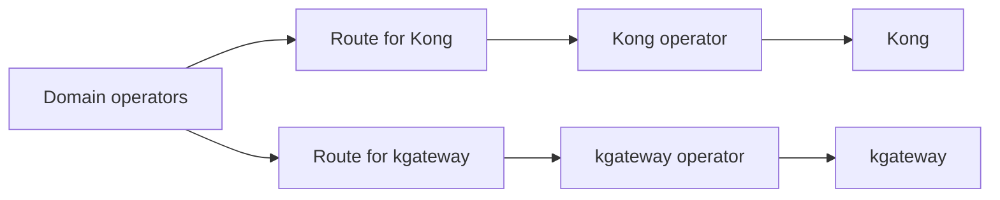
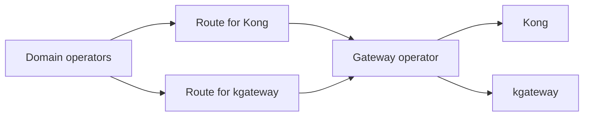
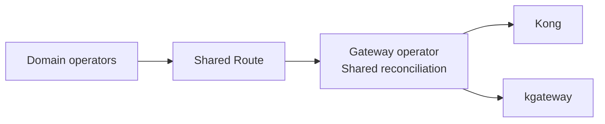

# dCP Gateway Architecture

## Context and Problem Statement

The distributed control plane (dCP) must configure both Kong and kgateway. Routing requirements come from several
domains and include features requested by both routes and their consumers.

Supporting both gateways raises questions about how many Route resources represent the desired routing, which
components configure each gateway, and where gateway eligibility is evaluated. A configuration change can succeed for
one gateway and fail for the other, so resource ownership, readiness and error handling need defined semantics.

How should the dCP organize Route resources and reconciliation to support both gateways?

This record decides the dCP architecture only. Traffic migration, rollout switches and configuration locations are
outside this decision.

## Decision Drivers

- Make partial success visible without disrupting a gateway that is still serving.
- Give configuration, status and cleanup clear ownership.
- Limit changes to domain operators, Route references and Route consumers.
- Evaluate route and consumer requirements consistently across domains.
- Limit redundant resources and reconciliation logic.
- Keep deployment, credential management and release complexity manageable.

## Considered Options

- **A:** Two Routes, two gateway operators.
- **B:** Two Routes, one gateway operator.
- **C:** One Route, one gateway operator with a shared reconciliation.
- **D:** One Route, one operator with two controllers.

## Decision Outcome

Chosen option: **D: One Route, one operator with two controllers**. Domain operators create one shared Route. A single
gateway operator contains separate Kong and kgateway controllers, each responsible for its gateway's configuration,
status and cleanup.

We choose D because it keeps gateway eligibility in the gateway layer without requiring gateway-specific Route creation
in every domain. Unlike A and B, it does not multiply Route resources and references. Unlike C, it separates the
gateways' reconciliation and retry paths. We accept the shared operator process and release lifecycle in exchange for
those benefits.

The shared controller framework must support independent controller ownership of status and cleanup. Readers of Route
readiness must distinguish the gateways' results rather than treating a failure of one as a failure of both.

The [dCP architecture guide](../developer/dcp-architecture.md) describes the decided flow and controller
responsibilities.

### Consequences

- Good, because domain operators and Route references do not need a second resource for kgateway.
- Good, because gateway-specific feature detection and selection stay in the gateway layer.
- Good, because each controller can reconcile, retry and clean up independently.
- Bad, because shared Route status and cleanup require explicit ownership in the controller framework.
- Bad, because both controllers share a process and its available credentials. This provides logical reconciliation
  isolation, not process or credential isolation; changes to either controller also change the shared operator binary.

## Pros and Cons of the Options

### A: Two Routes, two gateway operators

Domain operators create a separate Route for each applicable gateway. Each gateway operator owns its Route and
configures its gateway. Route producers determine whether to create the additional Route.

- Good, because each Route has its own status and cleanup lifecycle.
- Good, because separate operator processes can isolate process failures and credential access.
- Good, because kgateway changes do not change the Kong operator binary.
- Bad, because it adds Route resources and an operator deployment.
- Bad, because each participating domain needs gateway-specific Route creation, selection and references.

### B: Two Routes, one gateway operator

Use the same two-Route model as A, but have one operator reconcile Routes for both gateways.

- Good, because it saves a deployment and shares reconciliation infrastructure.
- Good, because each gateway's Route has its own status.
- Bad, because workload and credential access share a process, and changes affect the same binary.
- Bad, because participating domains still need to create and reference separate Routes.

### C: One Route, one gateway operator

A single Route represents both gateway targets, and one controller configures both gateways in a shared reconciliation.

- Good, because it avoids duplicate Routes.
- Good, because gateway eligibility can be evaluated centrally for Routes from all domains.
- Bad, because a shared reconciliation couples progress and retries unless it explicitly handles partial success.
- Bad, because one controller must coordinate both gateways' readiness and cleanup; a combined failure result can
  affect Route consumers even while one gateway is serving.

### D: One Route, one operator with two controllers

Domain operators create one shared Route. Separate Kong and kgateway controllers in one gateway operator reconcile it
with independent status and cleanup.

Kubebuilder removed blanket advice against multiple controllers reconciling the same custom resource in
[kubernetes-sigs/kubebuilder#4537](https://github.com/kubernetes-sigs/kubebuilder/pull/4537). The discussion explains
that separate resources do not inherently solve update conflicts or status ownership. This supports evaluating D by its
responsibility boundaries, not rejecting it solely for sharing a Route. Controllers still need conflict handling and
must preserve each other's status conditions and cleanup state.

- Good, because it avoids duplicate Routes and domain-specific gateway selection.
- Good, because independent controllers separate gateway reconciliation and lifecycle ownership.
- Bad, because the shared controller framework must support that separation on one resource.
- Bad, because the operator process, available credentials and release lifecycle remain shared.

The flow diagram for this option is in the [dCP architecture guide](../developer/dcp-architecture.md#overview).
