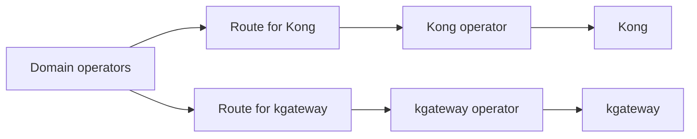
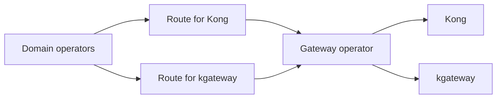
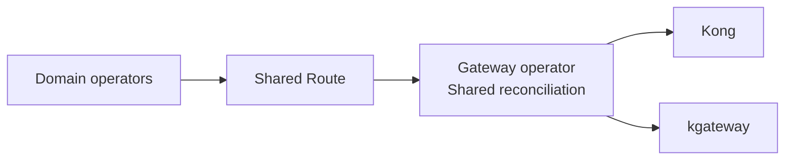
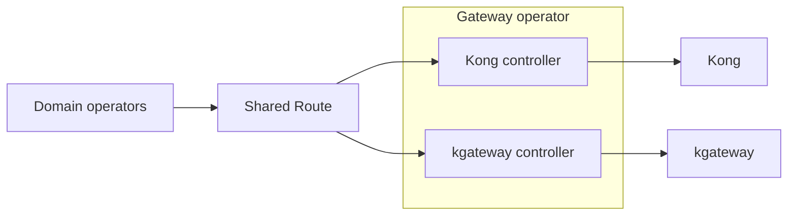

# dCP Gateway Architecture

## Context and Problem Statement

The distributed control plane (dCP) must configure both Kong and kgateway. Routing requirements come from several
domains and include features requested by both routes and their consumers.

Supporting both gateways raises questions about how many Route resources represent the desired routing, which components
configure each gateway, and where gateway eligibility is evaluated. A configuration change can succeed for one gateway
and fail for the other, so resource ownership, readiness and error handling need defined semantics.

How should the dCP organize Route resources and reconciliation to support both gateways?

This record decides the dCP architecture only. Traffic migration, rollout switches and configuration locations are
outside this decision.

## Decision Drivers

- Make partial success visible without disrupting a gateway that is still serving.
- Give configuration, status and cleanup clear ownership.
- Limit changes to domain operators, Route references and Route consumers.
- Evaluate route and consumer requirements consistently across domains.
- Limit redundant resources and reconciliation logic.
- Keep deployment, credential management and release complexity manageable.

## Considered Options

- **A:** Two Routes, two gateway operators.
- **B:** Two Routes, one gateway operator.
- **C:** One Route, one gateway operator with a shared reconciliation.
- **D:** One Route, one operator with two controllers.

## Decision Outcome

Chosen option: **D: One Route, one operator with two controllers**. Domain operators create one shared Route. A single
gateway operator contains separate Kong and kgateway controllers, each responsible for its gateway's configuration,
status and cleanup.

We choose D because it keeps gateway eligibility in the gateway layer without requiring gateway-specific Route creation
in every domain. Unlike A and B, it does not multiply Route resources and references. Unlike C, it separates the
gateways' reconciliation and retry paths. We accept the shared operator process and release lifecycle in exchange for
those benefits.

The shared controller framework must support independent controller ownership of status and cleanup. Readers of Route
readiness must distinguish the gateways' results rather than treating a failure of one as a failure of both.

The diagram of the decided flow is in [option D](#d-one-route-one-operator-with-two-controllers).

### Consequences

- Good, because domain operators and Route references do not need a second resource for kgateway.
- Good, because gateway-specific feature detection and selection stay in the gateway layer.
- Good, because each controller can reconcile, retry and clean up independently.
- Bad, because shared Route status and cleanup require explicit ownership in the controller framework.
- Bad, because both controllers share a process and its available credentials. This provides logical reconciliation
  isolation, not process or credential isolation; changes to either controller also change the shared operator binary.

## Pros and Cons of the Options

### A: Two Routes, two gateway operators

Domain operators create a separate Route for each applicable gateway. Each gateway operator owns its Route and
configures its gateway. Route producers determine whether to create the additional Route.

- Good, because each Route has its own status and cleanup lifecycle.
- Good, because separate operator processes can isolate process failures and credential access.
- Good, because kgateway changes do not change the Kong operator binary.
- Bad, because it adds Route resources and an operator deployment.
- Bad, because each participating domain needs gateway-specific Route creation, selection and references.

### B: Two Routes, one gateway operator

Use the same two-Route model as A, but have one operator reconcile Routes for both gateways.

- Good, because it saves a deployment and shares reconciliation infrastructure.
- Good, because each gateway's Route has its own status.
- Bad, because workload and credential access share a process, and changes affect the same binary.
- Bad, because participating domains still need to create and reference separate Routes.

### C: One Route, one gateway operator

A single Route represents both gateway targets, and one controller configures both gateways in a shared reconciliation.

- Good, because it avoids duplicate Routes.
- Good, because gateway eligibility can be evaluated centrally for Routes from all domains.
- Bad, because a shared reconciliation couples progress and retries unless it explicitly handles partial success.
- Bad, because one controller must coordinate both gateways' readiness and cleanup; a combined failure result can affect
  Route consumers even while one gateway is serving.

### D: One Route, one operator with two controllers

Domain operators create one shared Route. Separate Kong and kgateway controllers in one gateway operator reconcile it
with independent status and cleanup.

Kubebuilder removed blanket advice against multiple controllers reconciling the same custom resource in
[kubernetes-sigs/kubebuilder#4537](https://github.com/kubernetes-sigs/kubebuilder/pull/4537). The discussion explains
that separate resources do not inherently solve update conflicts or status ownership. This supports evaluating D by its
responsibility boundaries, not rejecting it solely for sharing a Route. Controllers still need conflict handling and
must preserve each other's status conditions and cleanup state.

- Good, because it avoids duplicate Routes and domain-specific gateway selection.
- Good, because independent controllers separate gateway reconciliation and lifecycle ownership.
- Bad, because the shared controller framework must support that separation on one resource.
- Bad, because the operator process, available credentials and release lifecycle remain shared.

#### Open question: end status of a shared Route

Both controllers reconcile the same Route, but readers expect one end status. The only reader of the Route's `Ready`
condition is the ConsumeRoute handler of the gateway operator. ApiSubscription waits for the ConsumeRoute, and
ApiExposure does not wait for its Routes. A single `Ready` keeps these readers and the domain operators unchanged.

During the migration, the Route's `gatewayRef` references the Kong `Gateway`, and Kong serves every Route as the
fallback. If kgateway serves a Route by path only, the requests go through kgateway. Kong's result then describes only
the fallback. If an update or a consumer change fails on kgateway while its HTTPRoute is live, kgateway serves an
outdated configuration, but Kong still reports `Ready=True`. For such a Route, the correct end status is: Kong is ready,
and kgateway is ready.

Today, the shared controller framework sets the `Ready` condition and one finalizer for every controller. Whatever
option we choose, a second controller on the Route needs its own condition type and finalizer.

- **1: The gateway in `gatewayRef` owns `Ready`.** Kong writes `Ready` during the migration, and kgateway writes
  `KgatewayReady`. In the end state, kgateway writes `Ready`.
  - Good, because neither the Kong controller nor any reader changes.
  - Good, because ownership follows `gatewayRef` and does not depend on the kgateway settings.
  - Bad, because `Ready` is wrong for a Route that kgateway serves by path only when its kgateway configuration fails.
- **2: Combine the conditions in the ConsumeRoute handler.** As in 1, but the ConsumeRoute handler treats a Route as
  ready if `Ready` is true and, for a Route that kgateway serves by path only, `KgatewayReady` is also true.
  - Good, because the Kong controller and the domain operators do not change. Only one function of the gateway operator
    changes.
  - Good, because subscriptions wait for kgateway where the traffic goes through kgateway.
  - Bad, because `Ready` on the Route itself still describes only Kong. Operators and monitoring must read two
    conditions.
- **3: Derive one combined `Ready`.** Kong writes `KongReady` and kgateway writes `KgatewayReady`. A shared step in the
  framework, or a small aggregating controller, sets `Ready` to `KongReady` and, for a Route that kgateway serves by
  path only, `KgatewayReady`.
  - Good, because the Route has one correct `Ready`, and no reader changes.
  - Good, because neither controller evaluates the settings of the other. The aggregation reads only the two conditions
    and the activation that kgateway reports.
  - Bad, because the Kong controller changes its condition type, and the framework or an additional controller changes.
  - Bad, because existing Routes have no combined `Ready` until the aggregation has run.
- **4: The kgateway settings decide which controller writes `Ready`.** Both controllers evaluate whether kgateway serves
  the Route by path only. Then kgateway writes `Ready`, otherwise Kong does.
  - Good, because the Route has one `Ready` that matches the path of the traffic.
  - Bad, because the Kong controller must read the kgateway settings, and both controllers must agree on eligibility.
  - Bad, because ownership of `Ready` moves between the controllers when the settings change, while both write.

In options 2 to 4, kgateway reports that it serves a Route by path only after kgateway has accepted the HTTPRoute, as
[ADR 0004](0004-use-an-oauth-proxy-for-cross-cluster-configuration.md) requires. Otherwise, a Route counts as served by
kgateway too early.
