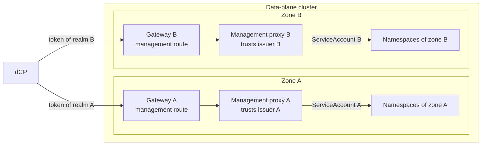
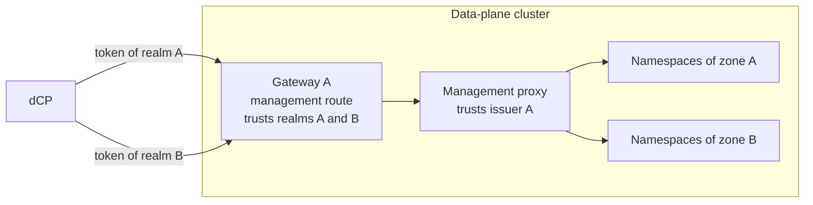
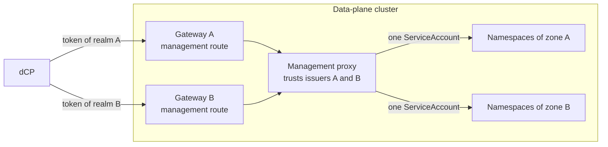

# Configure Several Zones in One Data-Plane Cluster

## Context and Problem Statement

Each zone has its own gateway: its own `Gateway`, hostnames, token minter and signing key, and its own issuer of the
Gateway Token. The dCP gets its caller token for a zone from the identity provider realm of that zone. The client ID of
the dCP is probably the same in all zones, so only the issuer of a token tells the zones apart.

Several zones can share one data-plane cluster. Today, two clusters run two zones each.
[ADR 0004](0004-use-an-oauth-proxy-for-cross-cluster-configuration.md#decision-outcome) proposes one proxy endpoint for
each data-plane cluster. The chart of the [management proxy](../developer/management-proxy.md) trusts exactly one
Gateway Token issuer for each release: `envoy.gatewayToken.issuer` and `envoy.gatewayToken.jwks.uri` take one value.

How do we configure the management proxy when several zones share a cluster? Must the management proxy know the zone of
a request, or does it only give access to namespaces, while the dCP puts the resources of each zone into the namespaces
of that zone?

## Decision Drivers

- The dCP decides which resources go into which zone and namespace, see
  [ADR 0004](0004-use-an-oauth-proxy-for-cross-cluster-configuration.md#validation-belongs-to-the-layer-that-owns-the-rule).
  The management proxy gives access. It enforces no rules about zones.
- A leaked signing key or caller credential of one zone gives no write access to another zone.
  [ADR 0005](0005-reuse-an-existing-kubernetes-api-proxy.md#protect-the-management-proxy-from-in-cluster-access) accepts
  that a leaked key gives write access to the routes of its own zone.
- The configuration of a zone does not depend on the gateway of another zone. We migrate one zone at a time
  ([ADR 0006][adr-0006]).
- Few chart changes and few values for each zone.
- Install nothing beyond the gateway chart
  ([ADR 0004](0004-use-an-oauth-proxy-for-cross-cluster-configuration.md#decision-drivers)). A cluster-scoped admission
  policy can be an option, but not a requirement.

## Considered Options

1. One release for each zone.
2. One release for each cluster, behind one management route that accepts the caller tokens of all zones.
3. One release for each cluster that trusts the Gateway Tokens of all zones, behind one management route for each zone.
4. Option 3, and the sidecar binds each issuer to the namespaces of its zone.

## Decision Outcome

Proposed option: **1, one release for each zone**, because Kubernetes RBAC keeps each zone in its own identity, and the
chart needs no change. ADR 0004 already says: "One endpoint grants one execution scope. Separate trust scopes need
separate identities." Each zone is a trust scope, with its own signing key and issuer.

The management proxy does not know zones. Each release serves one zone. It trusts the Gateway Token issuer of that zone,
and its ServiceAccount writes only the namespaces of that zone. The dCP selects the zone: it calls the management
endpoint of the zone with a token from the realm of the zone, and it writes the resources of the zone only into the
namespaces of the zone. The guide describes
[the values and the rules for the dCP](../developer/management-proxy.md#configure-several-zones-in-one-cluster).

If we prefer one release for each cluster, choose option 3. It needs the
[chart changes for option 3](#required-for-option-3). Option 3 also keeps zones out of the management proxy: the sidecar
trusts several issuers, but it does not map them to namespaces. The difference is the scope of a leaked key or
credential: with option 3, it covers all zones of the cluster.

The [considerations](#considerations-for-all-options) apply to every option.

## Pros and Cons of the Options

### One release for each zone

- Good, because the chart works without a change. A test render of two releases with different names, in one namespace
  and in two namespaces, showed no name collision. The selectors of the Deployment, Service, PodDisruptionBudget and
  NetworkPolicy, the certificates, the Secrets and the ServiceAccount differ for each release.
- Good, because Kubernetes RBAC separates the zones. A leaked signing key or a caller token of zone A reaches only the
  namespaces of zone A. The Kubernetes audit events name the ServiceAccount of the zone.
- Good, because each zone keeps its own management route, gateway and release. A rollout or an outage in one zone does
  not stop the configuration of another zone.
- Neutral, because the dCP keeps one client and one watch cache for each zone, also when two zones share a cluster. ADR
  0004 already uses one cache for each target. Each cache watches only the namespaces of its zone.
- Bad, because each zone runs its own Deployment. By default, these are 2 pods that request 200m CPU and 256 MiB memory
  together.
- Bad, because the separation depends on correct values for each zone. The chart checks only the namespaces of its own
  release, see [Writable namespaces](#writable-namespaces).

### One management route for all zones

- Good, because the chart works without a change. `route.issuers` accepts several issuers. The JWT GatewayExtension of
  gateway A needs a provider for each realm.
- Good, because each cluster runs one release.
- Bad, because the configuration of zone B depends on the gateway of zone A. A rollout, an outage or the migration of
  zone A stops it.
- Bad, because the gateway of zone A trusts the realm of zone B. The [Custom Ingress IDP][custom-ingress-idp] rules let
  each base path trust exactly one issuer. A second issuer needs the approval of a zone operator, and possibly a
  security exception.
- Bad, because the Gateway Token does not keep the issuer of the caller token. The sidecar cannot tell the zones apart,
  and one ServiceAccount writes the namespaces of all zones. A leaked signing key of zone A gives write access to zone
  B.

### One release that trusts the Gateway Tokens of all zones

- Good, because each cluster runs one release.
- Good, because each zone keeps its own management route on its own gateway.
- Good, because Envoy supports several issuers. A local test with Envoy v1.40.2 used two providers with the same
  `payload_in_metadata` key and a `requires_any` rule. Envoy accepted a token of each issuer. It rejected a token of a
  third issuer and a token with the issuer of zone B but the key of zone A with `401`. The RBAC filter read the client
  claim of both issuers from the same metadata key. The chart does not render this configuration yet.
- Bad, because the chart needs the [changes for option 3](#required-for-option-3).
- Bad, because one ServiceAccount writes the namespaces of all zones of the cluster. A leaked signing key of any zone
  gives write access to the routes of all zones in the cluster. ADR 0005 accepts this impact for one zone only.
- Bad, because the zones share one failure domain. A rollout or a broken configuration of the release affects all zones
  of the cluster.
- Bad, because the Kubernetes audit events no longer show the zone. Only the sidecar log can show it, with the issuer as
  an additional field. `allowedClients` does not help, because the dCP uses the same client ID in all zones.

### One release, and the sidecar binds each issuer to its namespaces

- Good, because it restores the separation of option 1 within one release.
- Bad, because the sidecar must parse Kubernetes API paths, for example `/apis/<group>/<version>/namespaces/<name>/…`,
  and handle discovery and requests without a namespace. This duplicates Kubernetes RBAC in CEL expressions.
- Bad, because the management proxy then enforces rules about zones. The drivers exclude this. ADR 0004 puts additional
  restrictions into Kubernetes admission, not into the proxy.
- Bad, because option 1 gives the same separation with Kubernetes RBAC and without a change.

## Considerations for All Options

A review of the chart with two releases in one cluster found these points. They apply to every option. The dCP and the
platform deployment handle them. The management proxy does not enforce them. The
[guide](../developer/management-proxy.md#configure-several-zones-in-one-cluster) lists the resulting values and rules.

### Release names

The Role and the RoleBinding in each target namespace have the name of the release, `<fullname>`. Two releases with the
same name in different namespaces render the same Role and RoleBinding when they share a target namespace. Helm refuses
the second install. Argo CD reports a shared resource instead, and each sync sets the subject of the RoleBinding to the
ServiceAccount of its own zone. The other zone then loses its access. Use the zone in the release name. Disjoint
namespaces, see the next section, also prevent the collision.

### Writable namespaces

`rbac.namespaces` must not overlap between zones. It must not contain the namespaces of the management proxy, the
management route, the Gateway or the GatewayExtensions of another zone. It must also not contain the
[global policy namespace][kgateway-global-policy] of kgateway, if set: policies there with `targetSelectors` attach to
routes in [all namespaces][kgateway-global-attach], so in all zones.

The chart refuses these namespaces only for its own release. A test render of zone A with the management namespace of
zone B in `rbac.namespaces` succeeds. The ServiceAccount of zone A then gets write access to the management HTTPRoute
and TrafficPolicy of zone B.

### Listeners

The guide requires a
[listener for the management route](../developer/management-proxy.md#configure-the-management-route-on-kgateway) that
admits only routes from the release namespace. The API listeners of each zone must also admit only routes from the
namespaces of that zone. Otherwise, an HTTPRoute of zone A can attach to the Gateway of zone B. With a longer path on a
hostname of zone B, it receives the traffic and the caller tokens of zone B. The gateway chart owns the listeners. The
dCP sets the `parentRefs` of an HTTPRoute only to the Gateway of its zone.

### GatewayExtensions of another zone

kgateway v2.3.0 resolves the `extensionRef` of a TrafficPolicy in another namespace
[without a ReferenceGrant][kgateway-extension-ref]. The management route of the chart relies on this behavior, because
the gateway chart owns the GatewayExtensions. So a TrafficPolicy of zone A can reference the token minter of zone B.
Gateway A then gets Gateway Tokens with the signing key of zone B, if the network lets gateway A reach that token
minter.

The dCP references only the GatewayExtensions of its zone. A NetworkPolicy on the token minter of each zone admits only
the gateway pods of that zone. A ValidatingAdmissionPolicy could also refuse such references, but it is cluster-scoped.

### Network peers

`networkPolicy.ingress.from` selects the gateway pods of the zone, with the namespace and the label
`gateway.networking.k8s.io/gateway-name`. A namespace selector alone admits the gateway pods of all zones that share the
gateway namespace. `networkPolicy.egress.jwks.to` selects the JWKS endpoint of the zone.

### Audience and path prefix

The guide plans an `aud` claim for each route. Use a different audience for the management route in each zone. Then the
sidecar of zone B also rejects a Gateway Token of zone A when both releases trust the same issuer by mistake. The same
`pathPrefix` in all zones is fine. The sidecar checks the method and the path, not the hostname, and the issuers differ.

### Shared kgateway controller

One kgateway controller serves the Gateways of all zones in the cluster. The zones share its GatewayClass, its CRD
versions and its global policy namespace. The GatewayClass is not an isolation boundary. The dCP must match the CRD
versions of the cluster for all its zones.

### Pod labels and topology spread

The `topologySpreadConstraints` example in `values.yaml` selects only `app.kubernetes.io/component`. With two releases
in one namespace, it spreads the pods of both zones together. Add `app.kubernetes.io/instance` to the selector.

`deployment.podLabels` must not set the selector labels `app.kubernetes.io/name` and `app.kubernetes.io/instance`, for
example to name the zone. The chart then renders a duplicate key, and kubeconform refuses the Deployment.

### Zones in logs, metrics and audit events

- The Kubernetes audit events name the ServiceAccount, `system:serviceaccount:<namespace>:<fullname>`. With one release
  for each zone, it identifies the zone.
- The `Audit-ID` is the request ID of the gateway. The caller can choose it, so it connects the logs of one request, but
  it does not identify the zone.
- The access log of the sidecar contains the client ID, but not the issuer. The Envoy metrics use the fixed prefix
  `management_proxy`. Log and metric collectors must keep the namespace and pod labels, which identify the release.

## Changes to the Management Proxy

### Optional for option 1

Option 1 needs no chart change. These small changes make mistakes in the values visible. None of them models zones.

- Add `rbac.protectedNamespaces`: a list of further namespaces that the chart refuses in `rbac.namespaces`, for example
  the namespaces of the other zones and the global policy namespace of kgateway. A Helm `lookup` cannot replace it,
  because it returns nothing under `helm template` and Argo CD.
- Add the issuer of the Gateway Token to the access log, from `%DYNAMIC_METADATA(envoy.filters.http.jwt_authn:…:iss)%`.
- Add `app.kubernetes.io/instance` to the `topologySpreadConstraints` example.
- Refuse the selector labels in `deployment.podLabels` with a clear message.

### Required for option 3

- Replace `envoy.gatewayToken` with a list, one entry for each zone: issuer, audiences and the JWKS settings (`uri`,
  `address`, `port`, `caConfigMap`, `cacheDuration`). `maxLifetime`, `clientClaim` and `requestBinding` can stay shared.
- Render one `jwt_authn` provider for each entry, each with its own JWKS cluster, and all with
  `payload_in_metadata: gateway_token`. Require the providers with `requires_any`. The RBAC filter, the request binding
  and the access log read `gateway_token`, so they stay the same.
- Mount the CA ConfigMap of each JWKS endpoint, with one SDS file for each entry.
- Add the issuer to the access log, as in option 1.
- Replace `route` with a list, one entry for each zone: `parentRefs`, `hostnames`, `jwtExtensionRef`,
  `extProcExtensionRef` and `issuers`. Render one HTTPRoute and one TrafficPolicy for each entry, all with the same
  backend Service. The one BackendConfigPolicy stays, because it targets the Service. `pathPrefix` stays shared.
- Refuse the namespaces of the Gateways and GatewayExtensions of all route entries in `rbac.namespaces`.
- With mutual TLS, the sidecar accepts one client DNS SAN. Either all gateways share one client certificate, or the
  chart accepts a list of SANs.
- Test the lists with helm-unittest, and run the sidecar test with two issuers.

`rbac.namespaces` then lists the namespaces of all zones. The NetworkPolicy values already take lists of peers.

## More Information

- [Management proxy guide](../developer/management-proxy.md#configure-several-zones-in-one-cluster): the values for each
  zone and the rules for the dCP
- [ADR 0003](0003-mint-the-gateway-token-in-a-custom-extproc.md): the Gateway Token and the signing key of a zone

[adr-0006]: https://github.com/telekom/gateway/blob/main/docs/decisions/0006-migrate-zones-with-kong-as-fallback.md
[custom-ingress-idp]: https://wiki.telekom.de/pages/viewpage.action?pageId=4047176972
[kgateway-global-policy]: https://github.com/kgateway-dev/kgateway/blob/v2.3.0/api/settings/settings.go#L218-L220
[kgateway-global-attach]: https://github.com/kgateway-dev/kgateway/blob/v2.3.0/pkg/krtcollections/policy.go#L899-L906
[kgateway-extension-ref]: https://github.com/kgateway-dev/kgateway/blob/v2.3.0/pkg/kgateway/extensions2/plugins/trafficpolicy/constructor.go#L132-L148
