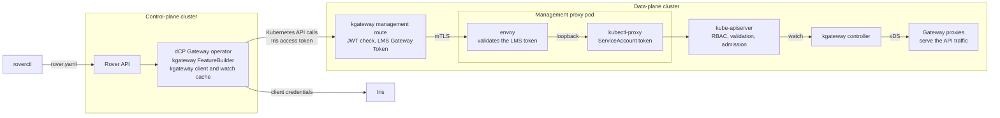

# Management Proxy

The management proxy lets the distributed control plane (dCP) reach the Kubernetes API of a data-plane cluster. An Envoy
sidecar authenticates each request. `kubectl proxy` forwards it to the Kubernetes API with a local ServiceAccount. This
guide describes how we package, configure and operate it, and what a proof of concept (PoC) showed.

| | |
| --- | --- |
| Status | Proposed design. Verified in a PoC with the current Kong gateway. Not implemented. |
| Decisions | [ADR 0004](../decisions/0004-use-an-oauth-proxy-for-cross-cluster-configuration.md): the dCP configures data-plane clusters through an OAuth-protected Kubernetes API proxy. [ADR 0005](../decisions/0005-reuse-an-existing-kubernetes-api-proxy.md): reuse an Envoy sidecar with `kubectl proxy`. |
| Terms | [ADR 0004](../decisions/0004-use-an-oauth-proxy-for-cross-cluster-configuration.md#context-and-problem-statement) |

## Overview

The diagram shows where the management proxy sits on the path from `roverctl` to the gateway proxies.
[ADR 0004](../decisions/0004-use-an-oauth-proxy-for-cross-cluster-configuration.md#write-and-clean-up-target-resources-safely)
shows the sequence of one configuration change.



## Packaging

Run Envoy and `kubectl proxy` as two containers with their upstream images. Build no image of our own. The PoC first
used one combined image in two containers. We changed it to the upstream images.

| Option | Good | Bad |
| --- | --- | --- |
| One container, combined image | One process list and one image. | Needs a process supervisor in the container. Kubernetes cannot restart one process alone, and probes cannot check each process. The exposed process shares the ServiceAccount token. We must build, scan and update the image. |
| Two containers, combined image | Kubernetes restarts each process alone. | Each container has the binary of the other. We must still build, scan and update the image. |
| Two containers, upstream images (chosen) | Nothing to build. Each image gets security fixes from its upstream project. Each container has only its own binary. Only the forwarder gets the ServiceAccount token. | Two image versions to track. |

Containers in one pod share the network namespace. So Envoy reaches `kubectl proxy` on the loopback address, and no
other pod can reach `kubectl proxy`.

## Pod layout

Run the management proxy as a separate Deployment with its own ServiceAccount. kgateway routes the management traffic to
the Service of this Deployment. Do not put `kubectl proxy` into the gateway pod. It would share the identity of the
gateway pod and would need supported deployment customization.

| Container | Image | Task |
| --- | --- | --- |
| `envoy` | `envoyproxy/envoy` | Listens on the Service port. Validates the LMS Gateway Token, authorizes the client and removes the token. Forwards to `127.0.0.1:8001` with the Host `localhost`. |
| `kubectl-proxy` | `registry.k8s.io/kubectl` | Runs `kubectl proxy --address=127.0.0.1 --port=8001 --accept-hosts=^localhost$`. Adds the ServiceAccount token. |

Mount the ServiceAccount token only into `kubectl-proxy`. Set `automountServiceAccountToken: false` on the pod. Add the
volume that Kubernetes mounts automatically as an explicit projected volume. The kubelet rotates the token, and
client-go reads the [token file again][token-file].

```yaml
spec:
  automountServiceAccountToken: false
  containers:
    - name: kubectl-proxy
      volumeMounts:
        - name: kube-api-access
          mountPath: /var/run/secrets/kubernetes.io/serviceaccount
          readOnly: true
  volumes:
    - name: kube-api-access
      projected:
        sources:
          - serviceAccountToken: { path: token, expirationSeconds: 3607 }
          - configMap: { name: kube-root-ca.crt, items: [{ key: ca.crt, path: ca.crt }] }
          - downwardAPI: { items: [{ path: namespace, fieldRef: { fieldPath: metadata.namespace } }] }
```

Run both containers as non-root, with a read-only root file system and without capabilities. `kubectl proxy` needs a
writable `HOME`, for example an `emptyDir` on `/tmp`.

## Configure the Envoy sidecar

The sidecar uses a static configuration with one route to `kubectl proxy`. It does not route. In this order:

1. The `jwt_authn` filter validates the LMS Gateway Token: signature, issuer and expiry. It gets the keys from the JWKS
   endpoint of the gateway. It removes the validated token from the request, because `forward` is `false` by default.
   This step is required: the client-go token transport [keeps an existing `Authorization` header][bearer-keep]. A
   forwarded caller token would reach the API server instead of the ServiceAccount token.
2. The `rbac` filter allows only the dCP client. It compares the `clientId` claim, and the `requestPath` claim with the
   prefix of the management route. Use `sourced_metadata` for these principals. Envoy v1.40
   [deprecates the `metadata` principal][envoy-sourced-metadata].
3. The router forwards the request. It rewrites the Host to `localhost`, because `kubectl proxy` has a default host
   filter.

We validated this configuration with `envoy --mode validate` (Envoy v1.40.2) and ran it in the PoC. The TLS settings of
the listener are not shown.

```yaml
static_resources:
  listeners:
    - name: management-proxy
      address:
        socket_address: { address: 0.0.0.0, port_value: 8443 }
      filter_chains:
        - filters:
            - name: envoy.filters.network.http_connection_manager
              typed_config:
                "@type": type.googleapis.com/envoy.extensions.filters.network.http_connection_manager.v3.HttpConnectionManager
                stat_prefix: management_proxy
                stream_idle_timeout: 900s # Longer than the 10-minute maximum watch of client-go.
                route_config:
                  virtual_hosts:
                    - name: kubernetes-api
                      domains: ["*"]
                      routes:
                        - match: { prefix: "/" }
                          route: # No retry_policy: Envoy does not retry.
                            cluster: kubectl-proxy
                            timeout: 0s # The default of 15 seconds ends every watch.
                            host_rewrite_literal: localhost
                            max_stream_duration:
                              max_stream_duration: 900s # Upper limit for a watch after its token expires.
                http_filters:
                  - name: envoy.filters.http.jwt_authn
                    typed_config:
                      "@type": type.googleapis.com/envoy.extensions.filters.http.jwt_authn.v3.JwtAuthentication
                      providers:
                        lms:
                          issuer: https://gateway.example.com/auth/realms/example
                          remote_jwks:
                            http_uri:
                              uri: https://gateway.example.com/auth/realms/example/protocol/openid-connect/certs
                              cluster: lms-jwks
                              timeout: 5s
                            cache_duration: 300s
                            async_fetch: {}
                          payload_in_metadata: lms
                      rules:
                        - match: { prefix: "/" }
                          requires: { provider_name: lms }
                  - name: envoy.filters.http.rbac
                    typed_config:
                      "@type": type.googleapis.com/envoy.extensions.filters.http.rbac.v3.RBAC
                      rules:
                        action: ALLOW
                        policies:
                          dcp-client:
                            permissions: [{ any: true }]
                            principals:
                              - and_ids:
                                  ids:
                                    - sourced_metadata:
                                        metadata_matcher:
                                          filter: envoy.filters.http.jwt_authn
                                          path: [{ key: lms }, { key: clientId }]
                                          value: { string_match: { exact: dcp-client-id } }
                                    - sourced_metadata:
                                        metadata_matcher:
                                          filter: envoy.filters.http.jwt_authn
                                          path: [{ key: lms }, { key: requestPath }]
                                          value: { string_match: { prefix: /management } }
                  - name: envoy.filters.http.router
                    typed_config:
                      "@type": type.googleapis.com/envoy.extensions.filters.http.router.v3.Router
  clusters:
    - name: kubectl-proxy
      type: STATIC
      load_assignment:
        cluster_name: kubectl-proxy
        endpoints:
          - lb_endpoints:
              - endpoint:
                  address:
                    socket_address: { address: 127.0.0.1, port_value: 8001 }
    # The cluster lms-jwks points to the JWKS endpoint of the gateway. It is not shown here.
```

The LMS Gateway Token carries these claims:

- `clientId`: the client of the caller.
- `operation`: the HTTP method.
- `requestPath`: the path on the gateway, with the prefix of the route and without the query.
- `exp`: the same expiry as the caller token.

Open: compare `operation` and `requestPath` with the method and path of each request. This binds a token to one request.
Envoy RBAC cannot compare two dynamic values without a CEL expression or a Lua filter.

The sidecar depends on the JWKS endpoint. While it has no valid keys in its cache, it rejects every request. Test key
rotation with the key rotator of the gateway.

## Keep watches working

A watch is one long HTTP response. The proxies check the token only when the request starts. The
[client-go reflector][reflector-timeout] ends each watch after a random time of 5 to 10 minutes. It
[resumes from the last `resourceVersion`][reflector-resume] and requests bookmarks. The API server sends a bookmark
about [once a minute][bookmark-frequency]. After `410 Gone`, the reflector [lists again][reflector-relist]. So a watch
survives the loss of a hop, if the client sees the loss.

A hop that reopens a watch without telling the client breaks this. With the same `resourceVersion`, the API server sends
events again that the client already has. Without a `resourceVersion`, the API server sends synthetic `ADDED` events for
all objects. In both cases, the client does not know about the restart. Follow these rules:

| Rule | Reason |
| --- | --- |
| No hop retries or reopens a request. Configure no retry on the management HTTPRoute, on its TrafficPolicy or on the sidecar route. | Envoy retries only with a `retry_policy`. A retry after a timeout hides the end of the stream from the client. |
| No hop buffers. Forward the response headers and each event at once. | Buffering delays events. Some proxies retry only while no response byte reached the client. |
| The idle timeout of each hop is longer than the bookmark interval, for example 15 minutes. | Bookmarks keep a quiet watch active. |
| The maximum stream duration is longer than the 10-minute maximum watch of client-go. | The client ends its own watches. The limit only ends watches of clients that do not. |
| A failing or stopping hop ends the client stream. Drain Envoy on shutdown. | The client reconnects to another replica and resumes. |
| Run at least 2 replicas with a PodDisruptionBudget and a readiness probe. | New watches go to a live replica during a rollout or a node drain. |
| The dCP uses informers, not raw watches. It reconciles to the desired state and applies with server-side apply. | A duplicate or replayed event causes at most an apply without changes. |

Configure each hop for streaming:

| Hop | Setting |
| --- | --- |
| kgateway management route | The [Envoy default route timeout][envoy-timeouts] is 15 seconds and stops watches. Set [`timeouts.request`][kgateway-timeouts] to `0s` in the TrafficPolicy of the route. Set `timeouts.streamIdle` longer than the bookmark interval. Envoy closes idle streams after 5 minutes by default. kgateway v2.3.0 has no field for a maximum stream duration. |
| Envoy sidecar | Set the route timeout to `0s` and the stream idle timeout as above. Do not add a buffering filter. Set `max_stream_duration` as an upper limit for clients that do not end their watches. |
| `kubectl proxy` | It [flushes streamed responses][kubectl-flush] every 200 milliseconds and sets no server timeouts. No setting is necessary. |
| kube-apiserver | It uses the `timeoutSeconds` value of the watch request. |

On kgateway, the TrafficPolicy of the management route sets the route timeouts. `timeouts.streamIdle` overrides the idle
timeout of the listener for this route only.

```yaml
apiVersion: gateway.kgateway.dev/v1alpha1
kind: TrafficPolicy
metadata:
  name: kubernetes-management
  namespace: gateway-management
spec:
  targetRefs:
    - group: gateway.networking.k8s.io
      kind: HTTPRoute
      name: kubernetes-management
  timeouts:
    request: 0s     # The Envoy default of 15 seconds ends every watch.
    streamIdle: 15m # Longer than the bookmark interval and the 10-minute maximum watch of client-go.
  # jwtAuth, rbac and extProc are not shown here. Do not configure a retry.
```

## Configure the management route on kgateway

Require valid JWTs in the `Authorization` header. Configure an explicit issuer and a rule for authorized clients. Check
the audience if the issuer sets one. An Iris client-credentials token that we inspected had no `aud` claim. The
[OAuth2/OIDC extension][kgateway-oidc] for browser login is a different flow. A tagged
[translator fixture][kgateway-jwt-rbac] shows CEL authorization based on JWT claims. The
[JWT translator][kgateway-jwt-translation] translates `forwardToken: false` into the removal of the validated token
header. Forward native Kubernetes requests without changes. Opaque tokens need an external-auth path.

### Accept tokens from more than one identity provider

The dCP gets its token from Iris. If a dCP must use another identity provider or another Iris realm, change only the
management route. The sidecar does not change. The gateway mints the LMS Gateway Token with the issuer of the route
realm, whichever issuer signed the caller token. The LMS Gateway Token does not keep the issuer of the caller token.

The [Custom Ingress IDP][custom-ingress-idp] concept sets the trust rules for issuers on API exposures. Each base path
trusts exactly one issuer. A zone operator approves each trusted issuer, and a second machine-to-machine identity
provider can need a security exception. Use the same rules for the management route.

Prefer one management route for each issuer, each with its own path prefix. The sidecar RBAC then binds each client to
the `requestPath` prefix of its route, and so to one issuer.

If one route must accept more than one issuer, add an entry for each issuer to the `providers` of the JWT
GatewayExtension. kgateway accepts a token that matches any entry, and writes the claims of all providers to the same
metadata key, `payload`. kgateway allows a request when any entry in `matchExpressions` is true. So check the issuer and
the client in the same expression:

```cel
metadata.filter_metadata['envoy.filters.http.jwt_authn']['payload']['iss'] == 'https://idp.example.com/realms/dcp' &&
metadata.filter_metadata['envoy.filters.http.jwt_authn']['payload']['clientId'] == 'dcp-client-id'
```

The name of the client claim can differ between identity providers, for example `clientId`, `azp` or `client_id`.

## Bootstrap the management route with the platform deployment

Bootstrap the management route with declarative Helm resources. An Argo CD Application manages these resources through
GitOps, independently of the dCP. For the initial composition, prefer one Application. An umbrella chart can package the
pinned upstream charts and a small subchart for the management bootstrap. As an alternative, keep the bootstrap
templates in the parent chart. Subcharts organize resources, but they do not set the order in which Argo CD applies
them. Argo CD renders the Helm templates and owns the deployment lifecycle.

Use [sync waves][argo-waves] on the rendered resources:

| Wave | Resources | Gate before the next wave |
| --- | --- | --- |
| `0` | Gateway API and kgateway CRDs. Namespaces, RBAC, Services and other prerequisites for the controller and the management proxy. | The required CRDs are `Established=True`. The supporting resources pass their health checks. |
| `1` | kgateway controller and management proxy Deployments | The Deployments are healthy. |
| `10` | The linked management resources: Gateway, GatewayParameters, JWT provider, TrafficPolicy and HTTPRoute | Observe the convergence of these resources together. The Gateway causes kgateway to provision Envoy. |

The upstream kgateway v2.3.0 chart supports [Deployment annotations][kgateway-deployment]. Set this value in the values
scope of that chart:

```yaml
deploymentAnnotations:
  argocd.argoproj.io/sync-wave: "1"
```

Annotate the bootstrap custom resources with wave `10`. The upstream CRD templates can keep the default wave `0`. Argo
CD v3.5.1 includes an [Established-aware CRD health check][argo-crd-health]. Verify that the installed version has an
equivalent check. Put policies and their target routes in the same wave. Otherwise, the health gate of an earlier policy
can wait for a route in a later wave. [Skipping the dry run for missing types][argo-dry-run] does not install CRDs or
make them ready. This proposal comes from source inspection. We have not rendered or deployed the combined chart.

A separate foundation Application of the platform can already own the CRDs. In that case, keep that ownership. Make the
bootstrap wait until that Application is synced and healthy. Waves in a parent Application wait for child Applications
only with a suitable [health assessment for Applications][argo-app-health]. Put the management resources outside the
write scope of the proxy ServiceAccount. Let the management listener accept routes only from the management namespace.
If the dCP cannot reach its management endpoint, recovery stays available through the Kubernetes deployment path of the
platform.

## Connect the dCP through the proxy

The dCP uses the same Kubernetes client as for its local resources. A sketch, adapted from the
[Kong client factory][client-factory]:

```go
cfg := &rest.Config{
    Host:            gw.Spec.Admin.Url, // management route, can contain a path prefix
    TLSClientConfig: rest.TLSClientConfig{CAData: trustedCA},
    WrapTransport:   transport.TokenSourceWrapTransport(ccConfig.TokenSource(ctx)), // Iris client credentials
}
c, err := client.New(cfg, client.Options{Scheme: scheme}) // Gateway API v1 and kgateway v1alpha1 types
```

- The [token source][oauth2-expiry] caches the token and gets a new one 10 seconds before it expires. It does not get a
  token for each request.
- Gateway API v1.5.1 supplies typed clients with apply configurations. kgateway v2.3.0 supplies Go types and a typed
  clientset, but no apply configurations, informers or listers. Use the controller-runtime client with server-side apply
  for both API groups.
- The field `gw.Spec.Admin.Url` is an example. The Gateway resource of the dCP needs a field for the management
  endpoint.

## Results of the proof of concept

The PoC ran in a virtual test cluster with the current Kong gateway in place of kgateway. Kong validated the Iris token
of the caller, and jumper minted the LMS Gateway Token. The sidecar used Envoy v1.40.2 and kubectl v1.36.0, with the
configuration above and a listener without TLS. ConfigMaps stood in for the Gateway API resources.

| Check | Result |
| --- | --- |
| Upstream images through the trusted Artifactory mirrors, without a pull secret | Works. |
| The sidecar gets the JWKS through the gateway Service in the cluster, and validates the LMS token | Works. |
| Discovery, list, server-side apply with `dryRun=All`, apply, update and delete through the gateway | Works. A dry run persists nothing. An invalid object returns `422` from Kubernetes. The field manager of the caller is kept. |
| The token is removed before `kubectl proxy` | Works. The authenticated requests succeed as the ServiceAccount. |
| Other namespaces and other resource types | `403` from Kubernetes for the ServiceAccount. |
| Another client with a valid LMS token | `403` from the sidecar RBAC. |
| An Iris token sent directly to the sidecar | `401`. The sidecar accepts only LMS tokens. |
| Calls from pods in another namespace and in the proxy namespace, without a token and with a forged unsigned token | `401` from the sidecar. `kubectl proxy` on the pod IP is unreachable. |
| ServiceAccount token in the `envoy` container | Not present. |
| Delete the only proxy pod during a watch, and change an object during the outage | The client sees the end of the stream. The gateway returns `504` during the outage. The client resumes from its last `resourceVersion` without a new list. It receives the change once and no event twice. |
| A watch without events for 90 seconds through Kong | Fails in 4 of 5 runs. After 60 seconds, Kong ends the request to the sidecar and sends it again. The client connection stays open and the client does not notice. The likely cause is the [Kong service defaults][kong-service-defaults]: a 60-second read timeout and 5 retries. |
| The same watch with bookmarks | The bookmark reaches the client before the timeout, so the later end of the stream is visible to the client. |

The Kong result shows why no hop may retry. Repeat the watch checks on the kgateway management route in the integration
tests. Not tested in the PoC: TLS and mTLS to the sidecar, kgateway, a graceful drain, 2 replicas and the rotation of
the ServiceAccount token.

## What we maintain

- We maintain no image. We track the versions of two upstream images.
- We maintain the Envoy configuration, the RBAC of the ServiceAccount and the bootstrap resources.
- The sidecar trusts only the LMS issuer of its gateway. It depends on the JWKS endpoint of that gateway.
- The correctness of watches depends on the configuration of every hop. The integration tests must check for hidden
  retries.

## More information

- The internal wiki page [Cross-cluster Configuration][security-wiki] lists the risk measures and the hardening of the
  management proxy.
- The internal wiki page [Custom Ingress IDP][custom-ingress-idp] describes the trust rules for identity providers other
  than Iris.

[token-file]: https://github.com/kubernetes/kubernetes/blob/d9e352346bb8aaf71fc86f956236fcd9806e8c5f/staging/src/k8s.io/client-go/transport/round_trippers.go
[bearer-keep]: https://github.com/kubernetes/client-go/blob/v0.37.0/transport/round_trippers.go#L310-L313
[envoy-sourced-metadata]: https://github.com/envoyproxy/envoy/blob/v1.40.2/api/envoy/config/rbac/v3/rbac.proto#L421-L438
[reflector-timeout]: https://github.com/kubernetes/client-go/blob/v0.37.0/tools/cache/reflector.go#L56-L58
[reflector-resume]: https://github.com/kubernetes/client-go/blob/v0.37.0/tools/cache/reflector.go#L590-L597
[reflector-relist]: https://github.com/kubernetes/client-go/blob/v0.37.0/tools/cache/reflector.go#L640-L650
[bookmark-frequency]: https://github.com/kubernetes/kubernetes/blob/v1.36.0/staging/src/k8s.io/apiserver/pkg/storage/cacher/cacher.go#L75-L77
[envoy-timeouts]: https://github.com/envoyproxy/envoy/blob/v1.35.0/docs/root/faq/configuration/timeouts.rst#L54-L110
[kgateway-timeouts]: https://github.com/kgateway-dev/kgateway/blob/v2.3.0/api/v1alpha1/shared/timeouts.go#L5-L21
[kubectl-flush]: https://github.com/kubernetes/kubernetes/blob/v1.35.0/staging/src/k8s.io/apimachinery/pkg/util/proxy/upgradeaware.go#L80-L91
[kgateway-oidc]: https://github.com/kgateway-dev/kgateway/blob/v2.3.0/docs/guides/oidc.md
[kgateway-jwt-rbac]: https://github.com/kgateway-dev/kgateway/blob/v2.3.0/pkg/kgateway/translator/gateway/testutils/inputs/jwt/rbac.yaml#L64-L96
[kgateway-jwt-translation]: https://github.com/kgateway-dev/kgateway/blob/v2.3.0/pkg/kgateway/extensions2/plugins/trafficpolicy/jwt.go#L199-L238
[argo-waves]: https://argo-cd.readthedocs.io/en/v3.5.1/user-guide/sync-waves/
[argo-crd-health]: https://github.com/argoproj/argo-cd/blob/v3.5.1/resource_customizations/apiextensions.k8s.io/CustomResourceDefinition/health.lua
[argo-dry-run]: https://argo-cd.readthedocs.io/en/v3.5.1/user-guide/sync-options/#skip-dry-run-for-new-custom-resources-types
[argo-app-health]: https://argo-cd.readthedocs.io/en/v3.5.1/operator-manual/upgrading/1.7-1.8/#health-assessment-of-argoprojioapplication-crd-has-been-removed
[kgateway-deployment]: https://github.com/kgateway-dev/kgateway/blob/v2.3.0/install/helm/kgateway/templates/deployment.yaml#L26-L36
[client-factory]: https://github.com/telekom/controlplane/blob/6c33e47adefa88ae4da0b7d5e701752f96020d65/gateway/pkg/kongutil/client_factory.go#L83-L99
[oauth2-expiry]: https://github.com/golang/oauth2/blob/v0.36.0/token.go#L19-L22
[kong-service-defaults]: https://github.com/Kong/kong/blob/3.9.1/kong/db/schema/entities/services.lua#L33-L42
[security-wiki]: https://wiki.telekom.de/spaces/DHEI/pages/4600044528/Cross-cluster+Configuration
[custom-ingress-idp]: https://wiki.telekom.de/pages/viewpage.action?pageId=4047176972
