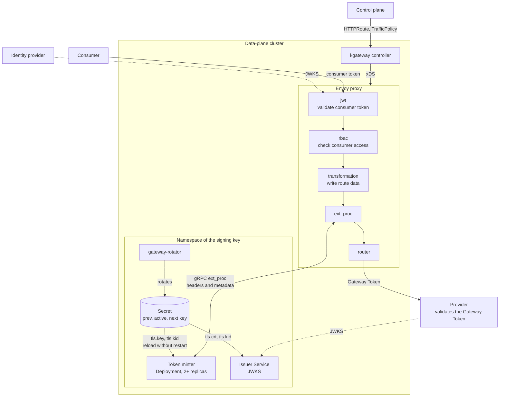
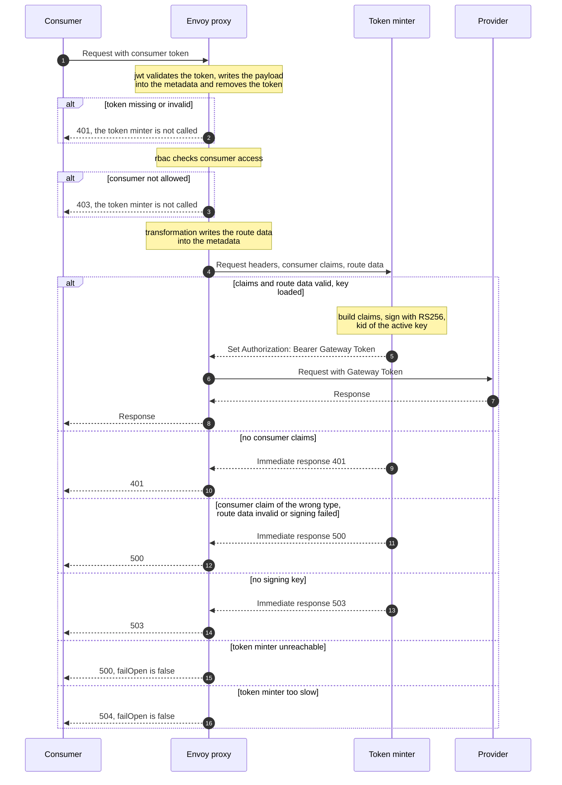

# Token Minter

<!--toc:start-->
- [Token Minter](#token-minter)
  - [Request flow](#request-flow)
  - [Deployment](#deployment)
    - [Locality](#locality)
  - [Consumer claims](#consumer-claims)
  - [Route data](#route-data)
  - [Claims of the Gateway Token](#claims-of-the-gateway-token)
    - [Known differences from gateway-jumper](#known-differences-from-gateway-jumper)
  - [Failure behaviour](#failure-behaviour)
  - [Route configuration](#route-configuration)
    - [GatewayExtension](#gatewayextension)
    - [TrafficPolicy per route](#trafficpolicy-per-route)
  - [Open checks](#open-checks)
<!--toc:end-->

The token minter mints the Gateway Token for routes with Last Mile Security (LMS). It is an Envoy external processor
(ExtProc). kgateway calls it after the filters `jwt` and `rbac`. It replaces the consumer token with a Gateway Token
that it signs with the key from [gateway-rotator](https://github.com/telekom/gateway-rotator). This guide describes the
contract with the control plane, how we deploy it, and what we still have to check.

| | |
| --- | --- |
| Status | Proposed design, based on the recommended options of ADR 0007 and ADR 0009. Both decisions are open, so the design can still change. Not implemented in this repository yet. A prototype was verified on a test cluster, see [Open checks](#open-checks). |
| Decisions | [ADR 0003](../decisions/0003-mint-the-gateway-token-in-a-custom-extproc.md): mint the Gateway Token in a custom ExtProc. [ADR 0007](../decisions/0007-choose-where-the-token-minter-runs.md) (proposed): where it runs. [ADR 0009](../decisions/0009-define-the-inputs-and-claims-of-the-token-minter.md) (proposed): its inputs and claims. [ADR 0010](../decisions/0010-carry-subscription-scopes-to-the-token-minter.md) (proposed): the `scope` claim. |
| Story | DHEI-21830 |

## Request flow

The architecture diagram shows the components and how the token minter gets its inputs and its key. It shows the
recommended options: the token minter runs as its own Deployment
([ADR 0007](../decisions/0007-choose-where-the-token-minter-runs.md)), and it gets its inputs as dynamic metadata
([ADR 0009](../decisions/0009-define-the-inputs-and-claims-of-the-token-minter.md)).



Envoy runs the filters in this order:

1. `jwt` validates the consumer token, writes its payload into the dynamic metadata and removes the token from the
   request.
2. `rbac` checks consumer access.
3. The transformation of the route writes the [route data](#route-data) into the dynamic metadata.
4. The token minter reads the consumer claims and the route data, builds the [claims](#claims-of-the-gateway-token),
   signs the token and sets `Authorization: Bearer <Gateway Token>`.

The sequence diagram shows one request, including the cases in which the request does not reach the provider.



## Deployment

This section describes the option that [ADR 0007](../decisions/0007-choose-where-the-token-minter-runs.md) recommends:
the token minter runs as its own Deployment in the namespace of the rotator Secret.

- At least two replicas per availability zone, a PodDisruptionBudget, and topology spread across availability zones with
  `maxSkew: 1` and `whenUnsatisfiable: DoNotSchedule`. A HorizontalPodAutoscaler scales on CPU, because RSA signing
  costs CPU on every request. Each zone needs its own capacity, see [Locality](#locality).
- The pod mounts the keys `tls.key` and `tls.kid` of the rotator Secret as a volume. It reloads them without a restart
  when the rotator changes the Secret.
- The readiness probe reports ready only when a valid key is loaded.
- On SIGTERM, the token minter keeps serving for `DRAIN_DELAY`, then stops the gRPC server gracefully. Kubernetes marks
  a terminating pod as not ready in its EndpointSlice, and the delay gives kgateway time to push the new endpoints to
  Envoy. Without the delay, Envoy keeps sending requests to a stopped pod and rejects them, because `failOpen` is
  `false`. `terminationGracePeriodSeconds` must be longer than `DRAIN_DELAY` plus `SHUTDOWN_TIMEOUT`.
- A Service exposes the gRPC port with port name `grpc` and `appProtocol: kubernetes.io/h2c`. It sets
  `trafficDistribution: PreferClose`, see [Locality](#locality).
- If the `GatewayExtension` is in another namespace, a `ReferenceGrant` in the namespace of the token minter allows its
  `backendRef` to the Service.
- A NetworkPolicy allows ingress to the gRPC port only from the Envoy pods. TLS between Envoy and the token minter is an
  [open check](#open-checks).

### Locality

Envoy does not reach the token minter through kube-proxy. kgateway sends the pod endpoints of the Service to Envoy, and
Envoy picks one per ExtProc stream. Without a locality setting, it picks pods in all availability zones, and with three
zones about two of three LMS requests cross a zone. Pod affinity and `internalTrafficPolicy: Local` do not change this,
because they act only on scheduling or on kube-proxy.

kgateway v2.5.0 reads `spec.trafficDistribution` of the Service
([`k8s.go`](https://github.com/kgateway-dev/kgateway/blob/v2.5.0/pkg/kgateway/extensions2/plugins/kubernetes/k8s.go#L104-L112))
and turns `PreferClose` into Envoy priorities by region and zone
([`prioritize.go`](https://github.com/kgateway-dev/kgateway/blob/v2.5.0/pkg/kgateway/endpoints/prioritize.go#L397-L428)).
It takes the zone of the Envoy pod and of each token minter pod from the labels of their nodes. Envoy then sends the
ExtProc streams to token minter pods in its own zone and uses another zone only when its own zone has no endpoint left
or too many unhealthy ones.

Envoy does not move traffic to another zone because the pods in its zone are busy. Each zone therefore needs enough
token minter pods for the LMS load of the Envoy pods in that zone. The HorizontalPodAutoscaler averages the CPU of all
pods, so a zone with more load can be overloaded while the average stays below the target. Watch the CPU per zone.

[ADR 0007](../decisions/0007-choose-where-the-token-minter-runs.md#consequences-of-the-recommended-option) explains why
we do not prefer the same node.

## Consumer claims

kgateway `jwt` writes the verified payload into the dynamic metadata namespace `envoy.filters.http.jwt_authn`, key
`payload`. The `GatewayExtension` forwards this namespace to the token minter. The token minter does not read the
`Authorization` header and does not trust identity headers.

## Route data

The control plane writes the route data into the dynamic metadata namespace `token-minter`, as
[ADR 0009](../decisions/0009-define-the-inputs-and-claims-of-the-token-minter.md) recommends. All values are strings.

| Key | Required | Content | Example |
| --- | --- | --- | --- |
| `issuer` | yes | Issuer URL of the realm, used as `iss`. The control plane takes it from `LmsIssuer` in the zone status. | `https://gateway-a.example.com/auth/realms/default` |
| `environment` | no | Environment name, used as `env` | `environment-a` |
| `apiBasePath` | yes | API base path, start of `requestPath` | `/team-a/echo/v1` |
| `pathPrefix` | yes | Path prefix that the route matches. The token minter removes it from `:path` to build `requestPath`. It matches like the Gateway API `PathPrefix` of the route: element by element, and a trailing `/` is ignored. Use the value of the `HTTPRoute` match. | `/default/team-a/echo/v1` |
| `audience` | no | Literal value of `aud`. Overrides the `aud` of the consumer token. | `my-provider` |
| `audienceFrom` | no | Source of `aud` that the token minter resolves per request. Only `ConsumerClientId`: the `clientId` claim of the consumer token. Excludes `audience`. | `ConsumerClientId` |

The token minter ignores unknown keys, so we can add keys without a breaking change.

kgateway v2.5.0 renders the values of the transformation as MiniJinja templates, although the field type is still called
`InjaTemplate`
([implementations](https://github.com/kgateway-dev/kgateway/blob/v2.5.0/docs/guides/transformation.md#implementations)).
The control plane must not write template syntax (`{{`, `{%`, `{#`) into them.

## Claims of the Gateway Token

The header is `alg: RS256`, `typ: JWT` and `kid`, the key ID of the active key (`tls.kid`).

| Claim | Value | If the source is missing |
| --- | --- | --- |
| `iss` | route `issuer` | reject (500) |
| `typ` | `Bearer` | |
| `azp` | static value from the configuration of the token minter, the same value as in gateway-jumper | |
| `sub` | consumer `sub` | omit |
| `clientId` | consumer `clientId` | omit |
| `originZone` | consumer `originZone` | omit |
| `originStargate` | consumer `originStargate` | omit |
| `operation` | HTTP method | |
| `requestPath` | `apiBasePath` + (`:path` without query, minus `pathPrefix`) | reject (500) |
| `env` | route `environment` | omit |
| `aud` | route `audience`, else consumer `clientId` if `audienceFrom` is `ConsumerClientId`, else consumer `aud`. One value is a string, several values are an array. | omit. With `audienceFrom` and no consumer `clientId`: reject (500) |
| `iat`, `exp` | copied from the consumer token | omit |

The claims follow the Gateway Token of gateway-jumper
([`TokenGeneratorService`](https://github.com/telekom/gateway-jumper/blob/main/src/main/java/jumper/service/TokenGeneratorService.java)),
without `scope`, see [Known differences from gateway-jumper](#known-differences-from-gateway-jumper). The test cases for
`requestPath` follow
[`pathHandling.feature`](https://github.com/telekom/gateway-jumper/blob/main/src/test/resources/features/pathHandling.feature).
[ADR 0009](../decisions/0009-define-the-inputs-and-claims-of-the-token-minter.md) explains why `iat` and `exp` are
omitted and not rejected.

The copied claims must have the type that gateway-jumper expects: `iat` and `exp` numbers, the others strings. The token
minter rejects a consumer token with another type (500), as gateway-jumper does. `jwt` already rejects a token in which
`sub` is not a string or `iat` or `exp` is not an integer. Only the token minter checks `clientId`, `originZone` and
`originStargate`.

### Known differences from gateway-jumper

gateway-jumper sets `aud` to the subscriber ID of a pub/sub request (header `x-pubsub-subscriber-id`) if neither the
route nor the consumer token has an audience. It also writes the claims `publisherId` and `subscriberId`. The token
minter does neither. Pub/sub is out of scope for now, and the token minter does not read identity data from request
headers. Routes for pub/sub stay on the current gateway.

On a mesh call, the consumer gateway sends a mesh token from the identity provider of the provider zone in
`Authorization`, and the original consumer token in the header `consumer-token`. In the provider zone, Kong moves the
original token back into `Authorization` before gateway-jumper mints the Gateway Token, so `sub`, `clientId`,
`originZone`, `originStargate` and `aud` describe the original consumer. The token minter reads only the payload that
`jwt` verified. On a mesh call, that is the mesh token, so these claims would describe the mesh client of the consumer
gateway. The `consumer-token` header would also reach the provider. Mesh is out of scope for now. Routes that receive
mesh calls stay on the current gateway. So do failover routes: the control plane gives them a list of target zones
(`routing_config`), and gateway-jumper picks a healthy zone and forwards over the mesh.

gateway-jumper writes the claim `scope`. The control plane sends the scopes of the route and the scopes of each
consumer's subscription in `jumper_config`, and gateway-jumper takes the entry of the consumer, else the entry of the
route. The token minter writes no `scope`, because route data has one value per route.
[ADR 0010](../decisions/0010-carry-subscription-scopes-to-the-token-minter.md) proposes how the scopes reach the token
minter. Until then, routes with scopes stay on the current gateway.

## Failure behaviour

The token minter answers with an immediate response. The body is a short JSON object with the status and a reason code.
It contains no claims and no token. The reason code is also in the `details` of the response, for the Envoy access log.

| Case | Status | Reason code |
| --- | --- | --- |
| No verified consumer payload in the metadata | 401 | `no_consumer_claims` |
| A copied consumer claim has the wrong type | 500 | `invalid_consumer_claims` |
| Route data missing or invalid | 500 | `invalid_route_data` |
| No signing key loaded | 503 | `no_signing_key` |
| Signing failed | 500 | `signing_failed` |

Envoy rejects the request if it cannot reach the token minter (500) or if the token minter does not answer within
`messageTimeout` (504), because `failOpen` is `false`. Both responses have an empty body, and the provider receives
nothing, see [Open checks](#open-checks).

Logs contain the reason code, the key ID, claim names, the request ID of Envoy (`x-request-id`) and the API base path of
the route. They never contain tokens, claim values or key material. The request ID connects a log line with the Envoy
access log.

## Route configuration

### GatewayExtension

The platform deployment creates one `GatewayExtension` for the token minter. Its `backendRef` points to the Service from
[Deployment](#deployment):

```yaml
apiVersion: gateway.kgateway.dev/v1alpha1
kind: GatewayExtension
metadata:
  name: token-minter
spec:
  extProc:
    grpcService:
      backendRef:
        name: token-minter
        namespace: token-minter-namespace
        port: 9000
    failOpen: false # the kgateway default is true
    filterStage:
      stage: Route
      predicate: Before # after the transformation of the route
    messageTimeout: 200ms
    routeCacheAction: Retain
    metadataOptions:
      forwarding:
        untyped:
          - envoy.filters.http.jwt_authn
          - token-minter
    processingMode:
      requestHeaderMode: SEND
      responseHeaderMode: SKIP
      requestBodyMode: NONE
      responseBodyMode: NONE
      requestTrailerMode: SKIP
      responseTrailerMode: SKIP
```

### TrafficPolicy per route

The control plane writes one `TrafficPolicy` for each route with LMS:

```yaml
apiVersion: gateway.kgateway.dev/v1alpha1
kind: TrafficPolicy
metadata:
  name: my-route
spec:
  targetRefs:
    - group: gateway.networking.k8s.io
      kind: HTTPRoute
      name: my-route
  jwtAuth:
    extensionRef:
      name: consumer-jwt # validationMode Strict and forwardToken false, both defaults
  rbac:
    action: Allow
    policy:
      matchExpressions:
        - "metadata.filter_metadata['envoy.filters.http.jwt_authn']['payload']['clientId'] in ['client-a']"
  transformation:
    request:
      dynamicMetadata:
        - namespace: token-minter
          key: issuer
          value:
            stringValue: https://gateway-a.example.com/auth/realms/default
        - namespace: token-minter
          key: environment
          value:
            stringValue: environment-a
        - namespace: token-minter
          key: apiBasePath
          value:
            stringValue: /team-a/echo/v1
        - namespace: token-minter
          key: pathPrefix
          value:
            stringValue: /default/team-a/echo/v1
  extProc:
    extensionRef:
      name: token-minter
```

- Keep `validationMode` `Strict` and `forwardToken` `false` on the JWT provider. `jwt` then removes the consumer token.
  A route without the token minter forwards no token, and the provider rejects the request.
- Multiple `matchExpressions` in `rbac` are combined with OR. Put conditions that must all hold into one expression.
- Do not attach the token minter to the whole `Gateway`. Gateway-wide policies also apply to routes without LMS, for
  example a fallback route. Such requests have no route data, and the token minter rejects them (500).

## Open checks

Check these on a test cluster with kgateway v2.5.0 and Gateway API v1.7.0, and record the result here. Results so far
are from a test cluster with the current gateway in parallel (2026-11-09).

| Check | Expected | Result |
| --- | --- | --- |
| The token minter sees `envoy.filters.http.jwt_authn` / `payload`. | Yes | Yes |
| At `Route`/`Before`, the token minter sees the metadata of the transformation. | Yes | Yes |
| At `Route`/`Before`, the token minter still runs after `jwt` and `rbac`. A 401 or 403 does not reach it. | Yes | Filter order in the Envoy config: `jwt`, `rbac`, transformation, `ext_proc`. A 401 from `jwt` and a 403 from `rbac` (token of another client) did not reach the token minter: no ExtProc stream in the Envoy stats, no log line. |
| Headers that the route sets are visible to the token minter. | No, the router sets them | |
| The token minter sees the original `:path`, before a `URLRewrite` of the route. | Yes | Yes. With `ReplacePrefixMatch` to `/rewritten`, the provider received `/rewritten/hello`, and `requestPath` was `/team-a/test-api/v1/hello`. |
| Envoy path normalization keeps `requestPath` equal to gateway-jumper for `%2F`, `//`, `/./` and `/../` in the path. | Same `requestPath` as `pathHandling.feature` | |
| Status code when the token minter is down, too slow, or returns an immediate response. The provider receives nothing. | 500 or 504 | Down (no endpoints): 500 with an empty body, the provider received nothing (Envoy stats: `ext_proc.streams_failed` 2, upstream requests equal to the minted tokens). Timeout (`messageTimeout` 1 ms): 504 with an empty body, the provider received nothing (`ext_proc.message_timeouts` 2). The token minter counts such tokens as minted, although Envoy discards them. |
| `Authorization` is gone when the token minter runs, and the header mutation sets it. | Yes | The provider receives only the Gateway Token. |
| `routeCacheAction: Retain` keeps the route after the header mutation. | Yes | Yes |
| Envoy balances the ExtProc streams across all pods of the Service. | Yes | Yes. 20 requests: 11 and 9 per pod. Envoy uses the pod endpoints with round robin and HTTP/2, one Envoy pod opened 4 connections to each token minter pod. |
| With `trafficDistribution: PreferClose` on the Service, the ExtProc cluster in the Envoy config has priorities by zone. Envoy sends the streams to token minter pods in its own zone and fails over to another zone when its zone has no pod left. | Yes | |
| Cost of the hop: latency of an LMS route minus the latency of a route without LMS, compared with the processing time in the token minter. | In one zone, the hop costs less than the signing | |
| A `BackendConfigPolicy` with TLS on the Service applies to the ExtProc cluster. | Yes | |
| A Gateway Token from the token minter and one from gateway-jumper validate against the same JWKS. | Yes | Yes. Same `kid` as gateway-jumper, verified against the JWKS of the Issuer Service. The claims are equal except `scope`. |
| A rate-limited request does not reach the token minter. | Yes | Yes. Local rate limit of one request per minute: `200 429 429`, Envoy `local_rate_limit.rate_limited` 2, one minted token. The global rate limit runs in the same stage (`RateLimit`), not tested. |
| After a Secret update, the token minter signs with the new key without a restart. An invalid update keeps the current key. | Yes | Yes. With a test Secret: new `kid` after the kubelet updated the volume, same pods, no restarts. After emptying the Secret, the log showed `keeping the current signing key`, and the pods stayed ready. |
