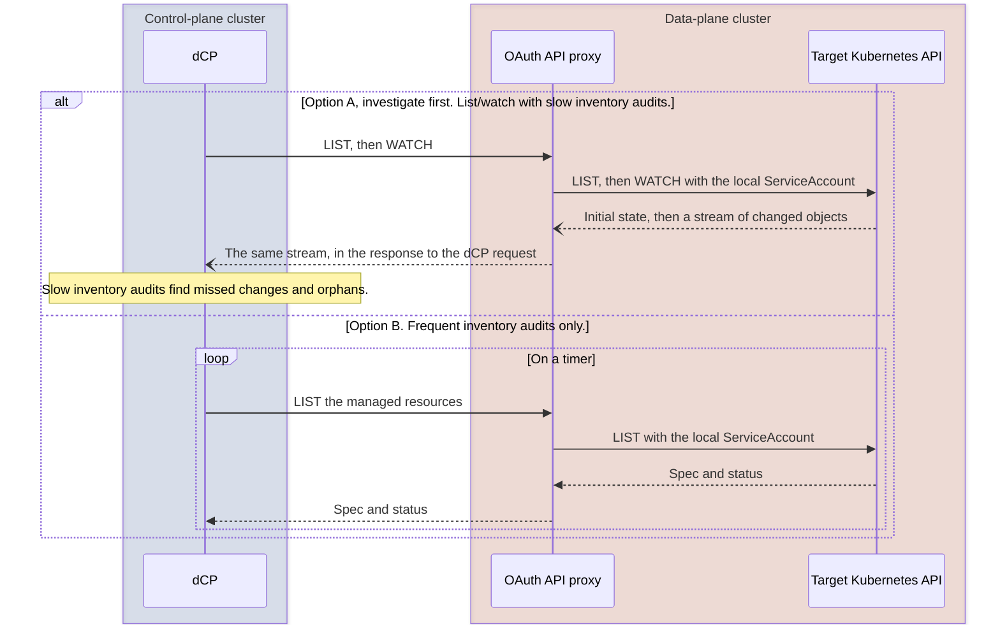
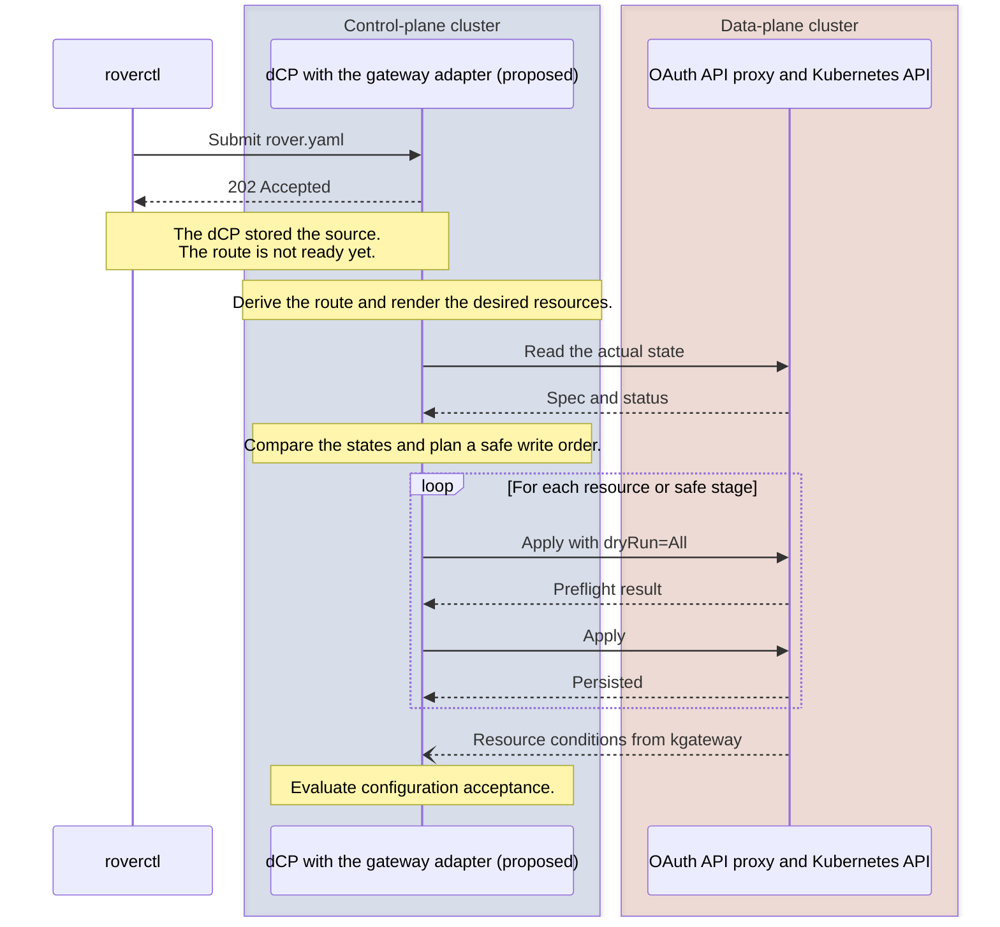
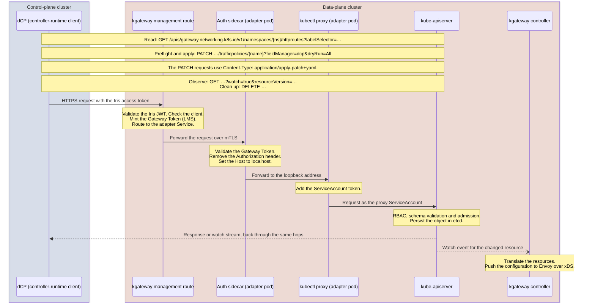

# Route configuration flow

These diagrams support [ADR 0004](../decisions/0004-use-an-oauth-proxy-for-cross-cluster-configuration.md) and
[ADR 0005](../decisions/0005-reuse-an-existing-kubernetes-api-proxy.md). They show a proposed design. Nobody has
implemented the new gateway integration yet.

The distributed control plane (dCP) owns the desired route configuration. It reaches each data-plane cluster only
through an OAuth-protected Kubernetes API proxy. The proxy forwards requests with a local ServiceAccount.

## Observe the target cluster

We compare two options. Both options use the same proxy and the same target Kubernetes API.

The dCP starts every request. No separate watcher or notification service runs in the data plane. For details, see
[Prefer a central watch over a separate notification service](../decisions/0004-use-an-oauth-proxy-for-cross-cluster-configuration.md#prefer-a-central-watch-over-a-separate-notification-service).

## Apply a route configuration

The dCP translates the configuration one time and owns the write order. Kubernetes validates each request with RBAC,
schemas and admission. A persisted resource is not ready yet. The dCP observes the kgateway conditions to decide
configuration acceptance. The meaning of the public `Ready` condition is still open. For details, see
[Observe configuration acceptance separately from serving](../decisions/0004-use-an-oauth-proxy-for-cross-cluster-configuration.md#observe-configuration-acceptance-separately-from-serving).

### Request path through the proxy

Each arrow from the dCP in the diagram above is an ordinary Kubernetes API call. This diagram shows the path of one call
through the data-plane cluster, in the composition with an authentication sidecar in the adapter pod. kgateway routes
the call. The sidecar only checks the request. It does not route.

A watch is one long HTTP response. Every hop must stream it without buffering and must allow its duration. See
[Connect the dCP through the proxy](../decisions/0005-reuse-an-existing-kubernetes-api-proxy.md#connect-the-dcp-through-the-proxy).

ADR 0005 has not selected a proxy product yet.
